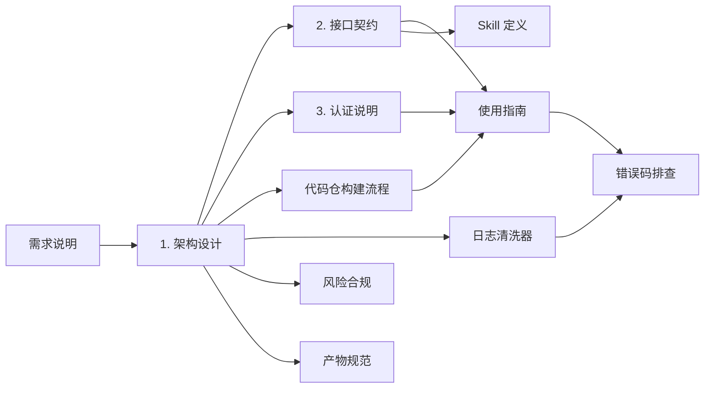

# AGENTS.md — CodeArtsBuild Skill 仓库代理指南

> 本文件面向在本仓库工作的 AI 代理/协作者：说明工程上下文、目录约定与工作规约。**代理修改本仓库前必读**。

## 工程上下文

- **语言**：TypeScript（strict + ESM）
- **运行时**：Node.js
- **形态**：dsh 插件（bundle）；云侧调用底层经 KooCLI（`hcloud`）承载（例外：`list_artifacts` 的 `ShowNewOutput` 需手动 HTTP 调用）

## 目录约定

| 路径 | 职责 |
|------|------|
| `skills/codeartsbuild/SKILL.md` | Skill 定义（工具清单/强制规约/建议操作路径），**LLM 编排依据** |
| `docs/api/api-contract.md` | 工具接口契约，**工具的唯一事实来源**，实现必须与之一致 |
| `docs/architecture/architecture.md` | 架构设计（v0.6） |
| `docs/design/repo-analyzer.md` | 本地构建流程（`repo_build` 规约） |
| `docs/design/log-cleaner.md` | 日志清洗规范 |
| `src/` | 插件实现；工具经 `ctx.tools.register(defineTool(...))` 注册 |
| `README.md` | 面向用户的项目入口（安装/使用/文档索引），**不含代理规约** |

## 工作规约

1. **文档先行**：所有实现以 `docs/architecture/architecture.md` 为准，代码与文档不一致视为缺陷。
2. **契约驱动**：`docs/api/api-contract.md` 是工具的唯一事实来源，先定契约再实现；改工具须同步更新契约。
3. **实测对齐**：华为云操作名/参数以 KooCLI 实测为准；未实测的标注"待确认"，不得臆造参数。
4. **v3/v4 禁用**：CodeArtsBuild `/v3/...`、`/v4/...` 旧版接口一律禁用；仅用 v1 推荐接口（白名单见 api-contract §1.4.3）。
5. **最小文档集**：不写空话，每个文档必须有可执行、可验证的内容。
6. **禁止擅自删除文件**：未经用户明确同意，禁止删除任何文件（含空临时文件）。删除前必须先询问并获得授权。

## 核心主键（数据来源强制关系）

| 主键 | 获取方式 | 需要它的工具 |
|------|----------|--------------|
| `project_id` | 用户手动填写（TODO：项目管理/维护拓展） | `create_job` / `list_records` |
| `job_id` | `create_job` 返回；或 `list_jobs` 按名称（`search`）搜索 | `get_job` / `update_job` / `delete_job` / `run_job` / `stop_job` / `get_status` |
| `build_no` | `run_job` 生成（每次构建独立，同 job 内递增） | `stop_job` / `wait_build` / `get_record` / `list_artifacts` / `get_status` |
| `record_id` | `get_record(jobId, buildNo)`（唯一来源） | `get_log` |

依赖链：`project_id →(用户填写) create_job → job_id → run_job → build_no → get_record → record_id → get_log`

## 文档间关系

## 待办事项

| # | 事项 | 状态 |
|---|------|------|
| 3 | projectId 项目管理/维护（自动选择、缓存、权限校验） | ⏳ 待办 |
| 10 | **架构缺口（P3，M2+）**：list_* 缓存策略、多会话并发隔离（run_job/wait_build/stop_job）、契约一致性测试（实现 vs api-contract）、KooCLI 版本兼容、配置优先级（env vs cordis config） | ⏳ 待办 |
| 12 | **流程优化**：`run_job`（或 wait_build 轮询）使用**子进程（child_process）**承载任务状态 loop，避免阻塞主进程；需评估子进程管理（超时/终止/回收） | ⏳ 待办 |
| 15 | **模板验证测试套**：调用实际接口，创建各种场景的自动化任务步骤，验证模板有效性（覆盖主要语言/场景组合） | ⏳ 待办 |
| 16 | **模板更新机制**：① step 模板——调用 `ListModulesDetail` 重新获取并评估更新；② config 模板——调用任意构建任务接口（`ShowJobConfig`）获取 config 评估更新 | ⏳ 待办 |
| 17 | ~~脚本迁移（HTTP 化）~~：`scripts/run-layer2.js` / `scripts/delete-jobs.mjs` 已迁移到 `HttpClient`（http-migration-plan.md §1.1），移除 CAB_AUTH_PROJECT_ID 依赖 | ✅ 完成 |
| 18 | ~~废弃文件清理~~：`src/infra/sdk-client.ts` / `sdk-proxy-patch.ts` / `lib/infra/koo-cli.js` 已删除 | ✅ 完成 |
