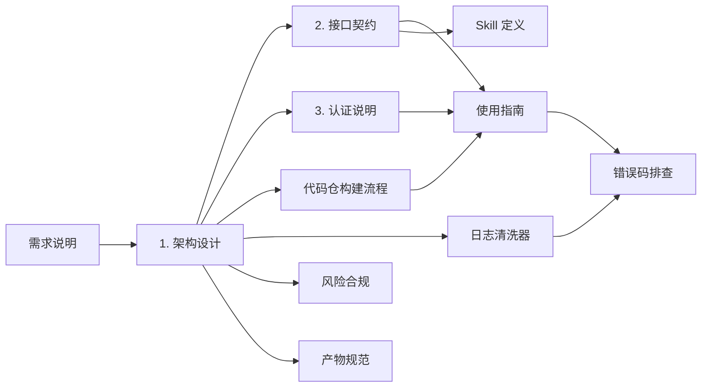

# AGENTS.md — CodeArtsBuild Skill 仓库代理指南

> 本文件面向在本仓库工作的 AI 代理/协作者：说明工程上下文、目录约定与工作规约。**代理修改本仓库前必读**。

## 工程上下文

- **语言**：TypeScript（strict + ESM）
- **运行时**：Node.js
- **形态**：dsh 插件（bundle）；云侧调用底层经**自建 HTTP 承载**（`fetch` + `AKSKSigner` AK/SK 签名，见 `src/infra/http-client.ts`），不再依赖 KooCLI/SDK

## 目录约定

| 路径 | 职责 |
|------|------|
| `skills/codeartsbuild/SKILL.md` | Skill 定义（工具清单/强制规约/建议操作路径），**LLM 编排依据** |
| `docs/api/api-contract.md` | 工具接口契约，**工具的唯一事实来源**，实现必须与之一致 |
| `docs/api/tools/` | 各工具契约详情（按工具拆分） |
| `docs/api/koocli-operation-reference.md` | KooCLI 操作列表参考资料（HTTP 实现接口名 ↔ URL 对照） |
| `docs/architecture/architecture.md` | 架构设计（概要设计） |
| `docs/design/FE-*.md` | 特性设计文档（FE-编号-{特性内容}-日期，独立迭代特性/详细设计） |
| `docs/test/TEST-*.md` | 测试设计文档（TEST-编号-{测试设计内容}-日期） |
| `src/` | 插件实现；工具经 `ctx.tools.register(defineTool(...))` 注册 |
| `README.md` | 面向用户的项目入口（安装/使用/文档索引），**不含代理规约** |

## 工作规约

1. **文档先行**：所有实现以 `docs/architecture/architecture.md` 为准，代码与文档不一致视为缺陷。
2. **契约驱动**：`docs/api/api-contract.md` 是工具的唯一事实来源，先定契约再实现；改工具须同步更新契约。
3. **实测对齐**：华为云操作名/参数以实测为准；未实测的标注"待确认"，不得臆造参数。
4. **v3/v4 禁用**：CodeArtsBuild `/v3/...`、`/v4/...` 旧版接口一律禁用；仅用 v1 推荐接口（禁用清单见 api-contract §1.4）。
5. **最小文档集**：不写空话，每个文档必须有可执行、可验证的内容。
6. **禁止擅自删除文件**：未经用户明确同意，禁止删除任何文件（含空临时文件）。删除前必须先询问并获得授权。
7. **特性设计（FE）规则**：独立迭代特性（架构评审决策、伪代码级详细设计等）**不得内联在 architecture.md**，须拆分为独立特性设计文档，命名格式 **`FE-编号-{特性内容}-日期`**（如 `FE-05-华为云调用承载方案对比评审决策-20260920.md`），存于 `docs/design/`；architecture.md 仅保留概要设计 + 指向 FE 文档的引用。编号顺序递增（FE-01 起），日期取定稿日（YYYYMMDD）。
8. **测试设计（TEST）规则**：测试设计文档存于 `docs/test/`，命名格式 **`TEST-编号-{测试设计内容}-日期`**（如 `TEST-02-Layer2全工具实调测试设计-20260921.md`）。

## 核心主键（数据来源强制关系）

| 主键 | 获取方式 | 需要它的工具 |
|------|----------|--------------|
| `project_id` | 用户手动填写（TODO：项目管理/维护拓展） | `create_job` / `list_records` |
| `job_id` | `create_job` 返回；或 `list_jobs` 按名称（`search`）搜索 | `get_job` / `update_job` / `delete_job` / `run_job` / `stop_job` / `get_status` |
| `build_no` | `run_job` 生成（每次构建独立，同 job 内递增） | `stop_job` / `wait_build` / `get_record` / `list_artifacts` / `get_status` |
| `record_id` | `get_record(jobId, buildNo)`（唯一来源） | `get_log` |

依赖链：`project_id →(用户填写) create_job → job_id → run_job → build_no → get_record → record_id → get_log`

## 文档间关系

## 待办事项

| # | 事项 | 状态 |
|---|------|------|
| 3 | projectId 项目管理/维护（自动选择、缓存、权限校验） | ⏳ 待办 |
| 10 | **架构缺口（P3，M2+）**：list_* 缓存策略、多会话并发隔离（run_job/wait_build/stop_job）、契约一致性测试（实现 vs api-contract）、配置优先级（env vs cordis config） | ⏳ 待办 |
| 12 | **流程优化**：`run_job`（或 wait_build 轮询）使用**子进程（child_process）**承载任务状态 loop，避免阻塞主进程；需评估子进程管理（超时/终止/回收） | ⏳ 待办 |
| 15 | **模板验证测试套**：调用实际接口，创建各种场景的自动化任务步骤，验证模板有效性（覆盖主要语言/场景组合） | ⏳ 待办 |
| 16 | **模板更新机制**：① step 模板——调用 `ListModulesDetail` 重新获取并评估更新；② config 模板——调用任意构建任务接口（`ShowJobConfig`）获取 config 评估更新 | ⏳ 待办 |
| 19 | **流程时序人工审查优化**：架构 §6 关键流程时序（G1/G2 时序图、修复闭环）需人工审查与实际实现（自建 HTTP 承载、wait_build 轮询、get_status 落定 ShowJobBuildRecordDetail）对齐；**同步优化 SKILL 设计**（建议操作路径与实测流程一致）——2026-09-28 S1 实测暴露 scm 编排缺陷，分析见 **FE-09**（repo_prepare 已有远端缺 repo_id / create_job 硬试超限 / agencyUrn 绕过） | ⏳ 待办 |
| 21 | **远端仓库先拉取本地构建通过后再创建任务**：codehub 远端 → git clone 到本地 → repo_build 验证 → create_job；编译不通过不创建（FE-07 §2.4，SKILL 仓库来源路由已更新） | ⏳ 待办 |
