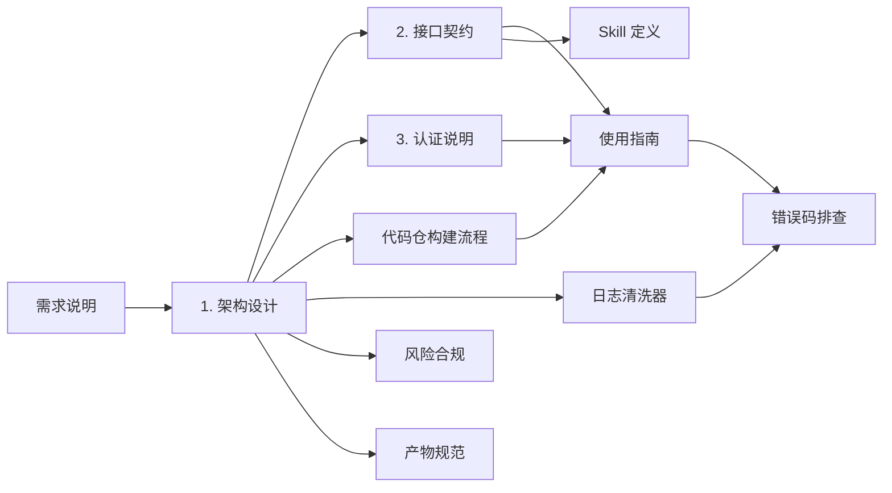

# AGENTS.md — CodeArtsBuild Skill 仓库代理指南

> 本文件面向在本仓库工作的 AI 代理/协作者：说明工程上下文、目录约定与工作规约。**代理修改本仓库前必读**。

## 工程上下文

- **语言**：TypeScript（strict + ESM）
- **运行时**：Node.js
- **形态**：dsh 插件（bundle）；云侧调用底层经**自建 HTTP 承载**（`fetch` + `AKSKSigner` AK/SK 签名，见 `src/infra/http-client.ts`），不再依赖 KooCLI/SDK

## 目录约定

| 路径 | 职责 |
|------|------|
| `skills/codeartsbuild/SKILL.md` | Skill 定义（工具清单/强制规约/建议操作路径），**LLM 编排依据** |
| `docs/api/api-contract.md` | 工具接口契约，**工具的唯一事实来源**，实现必须与之一致 |
| `docs/api/tools/` | 各工具契约详情（按工具拆分） |
| `docs/api/koocli-operation-reference.md` | KooCLI 操作列表参考资料（HTTP 实现接口名 ↔ URL 对照） |
| `docs/architecture/architecture.md` | 架构设计（概要设计） |
| `docs/design/FE-*.md` | 特性设计文档（FE-编号-{特性内容}-日期，独立迭代特性/详细设计） |
| `docs/test/TEST-*.md` | 测试设计文档（TEST-编号-{测试设计内容}-日期） |
| `src/` | 插件实现；工具经 `ctx.tools.register(defineTool(...))` 注册 |
| `README.md` | 面向用户的项目入口（安装/使用/文档索引），**不含代理规约** |

## 工作规约

1. **文档先行**：所有实现以 `docs/architecture/architecture.md` 为准，代码与文档不一致视为缺陷。
2. **契约驱动**：`docs/api/api-contract.md` 是工具的唯一事实来源，先定契约再实现；改工具须同步更新契约。
3. **实测对齐**：华为云操作名/参数以实测为准；未实测的标注"待确认"，不得臆造参数。
4. **v3/v4 禁用**：CodeArtsBuild `/v3/...`、`/v4/...` 旧版接口一律禁用；仅用 v1 推荐接口（禁用清单见 api-contract §1.4）。
5. **最小文档集**：不写空话，每个文档必须有可执行、可验证的内容。
6. **禁止擅自删除文件**：未经用户明确同意，禁止删除任何文件（含空临时文件）。删除前必须先询问并获得授权。
7. **特性设计（FE）规则**：独立迭代特性（架构评审决策、伪代码级详细设计等）**不得内联在 architecture.md**，须拆分为独立特性设计文档，命名格式 **`FE-编号-{特性内容}-日期`**（如 `FE-05-华为云调用承载方案对比评审决策-20260920.md`），存于 `docs/design/`；architecture.md 仅保留概要设计 + 指向 FE 文档的引用。编号顺序递增（FE-01 起），日期取定稿日（YYYYMMDD）。
8. **测试设计（TEST）规则**：测试设计文档存于 `docs/test/`，命名格式 **`TEST-编号-{测试设计内容}-日期`**（如 `TEST-02-Layer2全工具实调测试设计-20260921.md`）。

## 核心主键（数据来源强制关系）

| 主键 | 获取方式 | 需要它的工具 |
|------|----------|--------------|
| `project_id` | 用户手动填写（TODO：项目管理/维护拓展） | `create_job` / `list_records` |
| `job_id` | `create_job` 返回；或 `list_jobs` 按名称（`search`）搜索 | `get_job` / `update_job` / `delete_job` / `run_job` / `stop_job` / `get_status` |
| `build_no` | `run_job` 生成（每次构建独立，同 job 内递增） | `stop_job` / `wait_build` / `get_record` / `list_artifacts` / `get_status` |
| `record_id` | `get_record(jobId, buildNo)`（唯一来源） | `get_log` |

依赖链：`project_id →(用户填写) create_job → job_id → run_job → build_no → get_record → record_id → get_log`

## 文档间关系

## 待办事项

| # | 事项 | 状态 |
|---|------|------|
| 3 | projectId 项目管理/维护（自动选择、缓存、权限校验） | ⏳ 待办 |
| 4 | **SKILL.md 注册到 ctx.skills（2026-11-04 已落地 + 2026-11-05 source 字段修复）**：插件 apply 时 `ctx.skills.register()` 注册同名 skill（`src/entry/skill.ts`；SKILL.md 随 npm 包发布——package.json files 含 skills/）；模型可用 `skill` 工具加载 / 用户 `/skill codeartsbuild` 注入；652fb005 会话实测验证 `skill` 工具能加载（`<skill_content name="codeartsbuild">` 完整渲染）；**FE-01 + repo_build 废弃（2026-11-06 已执行）**：FE-14 废弃决策落地——删 `src/providers/local-build/`、`tests/repo-build.test.ts`、契约 §2.16、`docs/api/tools/repo_build.md`、`docs/design/FE-01-*.md`、`src/tools/schemas.ts`（遗留未用）；工具数 19→18；契约/SKILL/architecture 引用清理 | ✅ 已完成 |
| 10 | **架构缺口（P3，M2+）**：list_* 缓存策略、多会话并发隔离（run_job/wait_build/stop_job）、契约一致性测试（实现 vs api-contract）、配置优先级（env vs cordis config） | ⏳ 待办 |
| 12 | **流程优化**：`run_job`（或 wait_build 轮询）使用**子进程（child_process）**承载任务状态 loop，避免阻塞主进程；需评估子进程管理（超时/终止/回收） | ⏳ 待办 |
| 15 | **模板验证测试套**：调用实际接口，创建各种场景的自动化任务步骤，验证模板有效性（覆盖主要语言/场景组合） | ⏳ 待办 |
| 16 | **模板更新机制**：① step 模板——调用 `ListModulesDetail` 重新获取并评估更新；② config 模板——调用任意构建任务接口（`ShowJobConfig`）获取 config 评估更新 | ⏳ 待办 |
| 19 | **流程时序人工审查优化**：架构 §6 关键流程时序（G1/G2 时序图、修复闭环）需人工审查与实际实现（自建 HTTP 承载、wait_build 轮询、get_status 落定 ShowJobBuildRecordDetail）对齐；**同步优化 SKILL 设计**（建议操作路径与实测流程一致）——2026-09-28 S1 实测暴露 scm 编排缺陷，分析见 **FE-09**（repo_prepare 已有远端缺 repo_id / create_job 硬试超限 / agencyUrn 绕过）；2026-10-15 S2 会话（58dccf5f）再暴露：update_job projectId 缺省 E_PARAM / repo_push 非 git 仓库撞 UNKNOWN / create_job 空 scms 先建 / private-token 凭据缺口，分析见 **FE-13**（2026-10-16 修复已落地）；2026-10-23 S3 会话（63534983）暴露 private-token 规约未遵守 / 模板挑选命中差 / 规约与机制脱节，分析见 **FE-15**（2026-10-26 修复已落地）；2026-10-26 S4 会话（b98a0fdc）暴露 repo_build 单次尝试对 uv 项目失败，分析见 **FE-14**（子 agent 自主探索方案，SKILL 意图 1/2 已改造为 subagent，待宿主挂载 subagent 三包后实测）；2026-11-02 S5 会话（e3c9f738）暴露 step 字段名 shellContent 被吞 / image 字面量未验证来源 / 推码分支决策失控（git reset --hard/push -f 撞受保护）/ language 速选命中差，分析见 **FE-16**（2026-11-03 修复已落地：字段契约机制化 + image 来源软引导 + 分支预检 + PROTECTED_BRANCH + language 模糊匹配）；2026-11-05 S6 会话（652fb005）暴露 shell-command 跑 Python 失败（pip: command not found）/ imageSource 拦截开销 / module_id 裸包名非白名单 / delete 重建而非 update 修复，分析见 **FE-17**（2026-11-05 修复已落地：模板选用 mismatch 机制化 + 移除 imageSource + module_id 白名单错误增强 + delete→update 引导）；2026-11-12 S7 会话（ed0ef1ff，llm-quant 仓库）暴露**技能未被主动先加载**（available_skills 目录含 codeartsbuild 且宿主 system-reminder 明确要求"先加载匹配技能再行动"，但模型 steps1-4 先做通用探索 15 次调用（read/glob/list_agents×2），step5 才加载技能）/ 加载后仍违反规约（create_job 空 scms 先建×2——scms_empty_hint 软提示被忽略，二犯；repo_push 撞 not_git_repo 后手动 pwsh git init 绕过推荐链路；PowerShell 5.1 不支持 && 致复制的命令链撞墙），分析见 **FE-19**（2026-11-12 修复已落地：skill 注册描述与 SKILL.md frontmatter 单一事实来源对齐（先加载指令 + 触发词）→ 目录条目强触发；create_job 空 scms → need_confirmation 软拦截（confirmEmptyScms 参数）；repo_push/get_push_credential/repo_prepare 复制命令 && → ; 便携化；SKILL 意图 1 补"本地非 git 仓库 git init 前置"） | ⏳ 待办 |
| 21 | **远端仓库先拉取本地构建通过后再创建任务**：codehub 远端 → git clone 到本地 → subagent 本地构建探索验证 → create_job；编译不通过不创建（FE-07 §2.4，SKILL 仓库来源路由已更新；FE-14 repo_build → subagent 子 agent 探索） | ⏳ 待办 |
