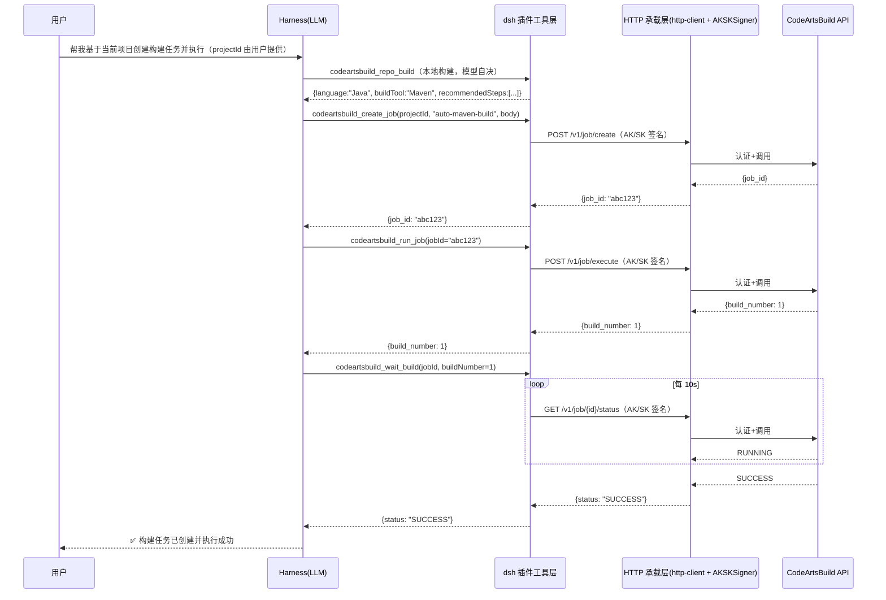
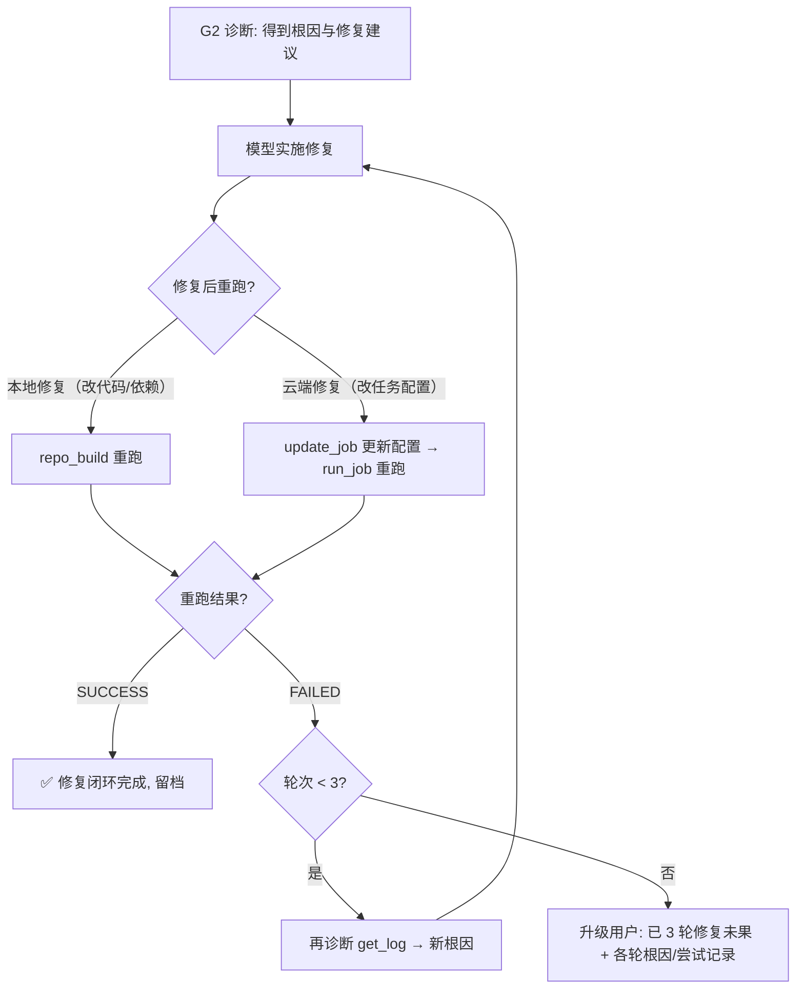

# CodeArtsBuild 构建插件 — 架构设计文档

> **文档编号**: CAB-ARCH-001  
> **版本**: v0.8.0（迭代由用户决定）  
> **日期**: 2026-09-20  
> **状态**: 待评审  
> **变更**: v0.7.9→v0.8.0 — 华为云调用承载从**华为云 SDK**反转为**自建 HTTP（AK/SK 签名）**（评审决策 2026-09-20）：仅保留 `huaweicloud-sdk-core` 签名库，业务请求自建 HTTP 构造；详见 §3.3.1 决策反转（特性文档 FE-05）

## 修订记录

| 版本 | 日期 | 说明 |
|------|------|------|
| v0.1.0 | 2026-09-15 | 初始架构草案（纯 MCP Server 方案） |
| v0.2.0 | 2026-09-15 | 重构：业务抽象层 + Harness 插件为主 + 代码仓感知 + 日志分析 |
| v0.3.0 | 2026-09-15 | 评审修订：全部华为云 API 调用（含 Token）改用 KooCLI；产物双链接；代码仓路由；日志按需获取 |
| v0.4.0 | 2026-09-16 | **dsh 主导**：技术选型以 dsh 插件为主；KooCLI 实测操作列表；状态枚举去除 INITIALIZING/ABORTED |
| v0.5.0 | 2026-09-16 | **接口版本体系**：v3 旧版禁用、v1/v4 新接口优先；核心操作表/禁用清单/待确认项按 Path 实测对齐 |
| v0.6.0 | 2026-09-16 | **专注 dsh**：移除 MCP 辅助形态；src 按模块分包；projectId 运行时定义；代码仓分析/日志清洗细节迁移至 `FE-01-本地代码仓构建流程设计-20260919.md` / `FE-02-日志清洗器规范-20260918.md` |
| v0.7.0 | 2026-09-17 | **契约同步（api-contract v0.4.3）+ 待办落定**：核心域接口签名与工具摘要对齐（ShowJobBuildRecordDetail/ShowNewOutput/ListOfficialTemplate/DownloadBuildFullLog）；wait_build 轮询参数（#4）、G2 修复闭环（#6）、projectId 会话级传递（#7）、local-build 分包上移（#9）、产物统一结构体（console_url 跳转） |
| v0.7.6 | 2026-09-18 | **openapi.yaml 对齐 + KooCLI 实调用确认（待办 #1）**：各工具输入输出按 openapi 校准（arch 枚举/module_id 全限定名/parameters 双层/run_job 响应/delete HTTP/list_records 分页等）；record_id 对应、ListRecords 36 位 UUID、ExecuteJob 分支、状态枚举冲突、CreateNewJob steps 必填、日志 ZIP 确认 |
| v0.7.8 | 2026-09-18 | **v4 禁用 + 一致性修复**：接口禁用规则扩至 **v3/v4 一律禁用（仅 v1 推荐）**；get_status 落定 `ShowJobBuildRecordDetail`；目录树补 `template-assembler.ts`；契约 v0.5.2 同步 |
| v0.7.9 | 2026-09-19 | **用户故事引用化**：§2.1 用户故事表改为引用 `docs/prd.md` §2（消除双维护，PRD 为准） |
| v0.8.0 | 2026-09-20 | **承载反转：SDK → 自建 HTTP（AK/SK 签名）**：华为云 SDK 业务客户端不可信（请求/响应处理黑盒、字段丢失等），改为基于接口契约自行构造 HTTP 请求（`fetch` + `AKSKSigner` 签名）；仅保留 `huaweicloud-sdk-core` 的签名库；新增 `infra/http-client.ts`，删除 `sdk-proxy-patch.ts`；region→endpoint 映射表内嵌（取消 SDK Region 依赖） |

---

## 1. 背景与目标

### 1.1 背景

Huawei Cloud **CodeArts Build（编译构建）** 是云上编译构建平台，支持 Maven / Gradle / Npm / Docker 等构建场景。开发者使用 **DeepSeek Harness（dsh）** 作为 AI 编码助手——dsh 以「一切皆插件」为核心设计，模型、工具、技能、会话、沙箱等所有 Agent 能力均由插件组合而成，可自由替换和灵活重组。但当前缺少与构建系统的集成能力。

当前痛点：
- 每次创建构建任务需手动在控制台操作，无法基于当前代码仓自动推断配置
- 构建失败后需人工登录控制台、翻找日志、定位原因
- 无自然语言入口，无法「一句话完成创建+执行+获取产物」
- dsh 生态缺少 CodeArtsBuild 插件，无法充分利用 Harness 的工具注册/技能/会话能力

### 1.2 目标

| 编号 | 目标 | 验收标准 |
|------|------|----------|
| G1 | 自动创建并执行构建 | 基于给定的项目，自动分析当前代码仓技术栈，创建构建任务并**执行成功** |
| G2 | 异常自动诊断 | 构建失败时自动**拉取日志**，清洗建模后交 LLM **分析根因**，给出可操作建议 |
| G3 | 获取构建产物 | 列出产物清单（按介质分类），提供**页面跳转链接**（当前版本不提供下载） |
| G4 | 构建状态监控 | 轮询等待构建进入终态 |
| G5 | 业务抽象 | 抽象构建生命周期核心域，以 **DeepSeek Harness 插件**（bundle）承载，专注 dsh 生态 |

### 1.3 非目标（本期不做）

- 不做构建任务图形化编排界面
- 不做构建机（Slave）管理
- 不做 IAM 账号/权限管理
- 不做非 CodeArtsBuild 的 Provider 实现（但架构预留扩展点）

### 1.4 术语表

| 术语 | 说明 |
|------|------|
| dsh / DeepSeek Harness | DeepSeek AI 的 Agent 运行时，`@deepseek-ai/dsh`；一切皆插件 |
| dsh 插件（bundle） | dsh 插件包：`apply(ctx)` 注册工具/命令/服务，含 `dsh.bundle` 声明与 `cordis.patch.yml` |
| cordis.yml | dsh profile 的插件实例声明文件（每实例一条插件配置） |
| Build Provider | 构建后端抽象（CodeArtsBuild 是第一个实现） |
| Build Job | 构建任务 |
| Build Record | 一次构建执行记录（build_no） |
| Artifact | 构建产物 |

---

## 2. 需求分析

### 2.1 用户故事

> 用户故事全量见 `docs/prd.md` §2（14 条，含 ID/角色/故事/优先级），本处为架构引用的要点速览，**以 PRD 为准**：

| ID | 角色 | 故事 | 优先级 |
|----|------|------|--------|
| US-1 | 开发者 | 列出我可见的 CodeArts 项目 | P0 |
| US-2 | 开发者 | 按项目列出所有构建任务及最近状态 | P0 |
| US-3 | 开发者 | 查看某个构建任务的完整配置 | P1 |
| US-4 | 开发者 | **基于当前代码仓自动创建构建任务并执行成功** | P0 |
| US-5 | 开发者 | 修改已存在的构建任务配置 | P2 |
| US-6 | 开发者 | 删除废弃的构建任务 | P2 |
| US-7 | 开发者 | 触发构建任务执行并指定分支/参数 | P0 |
| US-8 | 开发者 | 停止误触发的构建 | P1 |
| US-9 | 开发者 | 查询构建状态并等待其完成 | P0 |
| US-10 | 开发者 | 查看构建历史记录 | P1 |
| US-11 | 开发者 | 获取构建产物清单（按介质分类）与页面跳转链接 | P0 |
| US-12 | 开发者 | 看到可用的构建步骤模板 | P1 |
| US-13 | 开发者 | **构建失败时自动获取日志并分析失败原因** | P0 |
| US-14 | 开发者 | 自动检测当前代码仓的技术栈（Maven/Npm/Gradle 等） | P0 |

### 2.2 业务场景抽象

功能需求映射不仅限于 CodeArtsBuild 具体接口，而是抽象为**构建生命周期业务场景**：

```
构建生命周期 (Build Lifecycle)
├── 场景 A: 项目感知       — 发现项目、任务列表
├── 场景 B: 代码仓分析     — 本地技术栈检测、构建配置推荐
├── 场景 C: 任务编排       — 创建/更新/删除构建任务
├── 场景 D: 执行控制       — 触发/停止/轮询
├── 场景 E: 状态监控       — 状态查询、历史记录
├── 场景 F: 产物管理       — 产物清单（按介质）、页面跳转查看
└── 场景 G: 故障诊断       — 日志拉取、清洗建模、AI 分析
```

每个场景由**核心域接口**定义，CodeArtsBuild 作为 Provider 实现这些接口。未来可接入其他构建后端（Jenkins / GitHub Actions / GitLab CI）。

### 2.3 非功能需求

| 类别 | 需求 | 指标 |
|------|------|------|
| 安全 | 凭据不外泄 | AK/SK 经凭据注入抽象提供（env / hcloud config），插件业务代码不接触明文，仅进程内签名；不出现在工具结果中 |
| 安全 | Token 管理 | AK/SK 签名无 token 依赖（不调 IAM），无获取/刷新负担 |
| 可靠 | 网络失败重试 | 幂等命令支持重试，限 3 次 |
| 性能 | 列表接口分页 | 默认 20 条/页，上限 100 |
| 性能 | 大日志管控 | 日志仅 error 分析时获取，按需截断 |
| 可扩展 | Provider 可插拔 | 新增 Provider 不改动适配层与 Skill 层 |
| 可观测 | 日志输出 | 统一走 stderr（不污染 stdio 协议） |

---

## 3. 总体架构

### 3.1 分层架构

```mermaid
flowchart TB
    subgraph TerminalLayer["终端层（dsh）"]
        DSH[dsh 插件<br/>apply(ctx) + defineTool 注册原生工具]
    end

    subgraph CoreDomain["核心业务域（与后端无关）"]
        direction LR
        S1[场景 A: 项目感知]
        S2[场景 B: 代码仓分析]
        S3[场景 C: 任务编排]
        S4[场景 D: 执行控制]
        S5[场景 E: 状态监控]
        S6[场景 F: 产物管理]
        S7[场景 G: 故障诊断]
    end

    subgraph ProviderLayer["Provider 层（可插拔）"]
        direction LR
        CAB[CodeArtsBuild Provider]
        FUT[...其他 Provider<br/>Jenkins / GHA<br/>预留]
    end

    subgraph Infra["基础设施层"]
        KOO[KooCLI 适配器<br/>hcloud 命令构造/执行/解析<br/>含 Token 获取]
        LOG[日志清洗器<br/>详见 FE-02-日志清洗器规范-20260918.md]
        REPO[代码仓分析器<br/>详见 FE-01-本地代码仓构建流程设计-20260919.md]
    end

    subgraph Cloud["Huawei Cloud"]
        IAMAPI[IAM API]
        CABAPI[CodeArtsBuild API]
    end

    DSH --> CoreDomain
    CoreDomain --> ProviderLayer
    CAB --> KOO
    CAB --> LOG
    CAB --> REPO
    KOO --> IAMAPI
    KOO --> CABAPI
```

### 3.2 设计原则

| 原则 | 说明 |
|------|------|
| **业务抽象优先** | 核心域定义构建生命周期场景接口，不绑定任何具体后端 |
| **DeepSeek Harness 专注** | 以 **dsh 插件**（bundle）为唯一终端形态，高度结合 Harness 能力：`ctx.tools.register(defineTool(...))` 注册原生工具、cordis 依赖注入、skill 机制、会话能力；**本期不做 MCP 辅助形态** |
| **Provider 可插拔** | CodeArtsBuild 是第一个 Provider，新增后端仅需实现 Provider 接口 |
| **本地代码仓感知** | 分析本地工作区文件自动推断技术栈和构建配置（详见 `FE-01-本地代码仓构建流程设计-20260919.md`） |
| **日志清洗→LLM 分析** | 插件负责拉取日志并结构化建模，根因分析交给 LLM（详见 `FE-02-日志清洗器规范-20260918.md`） |
| **华为云调用承载** | CodeArtsBuild OpenAPI 调用经**自建 HTTP 客户端**（基于接口契约自行构造请求 + AK/SK 签名）承载，凭据经**凭据注入抽象**注入（保留"插件不接触明文"承诺）；详见 §3.3 技术选型 |

### 3.3 技术选型

| 项 | 选型 | 理由 |
|----|------|------|
| 语言 | TypeScript / Node.js 20+ | dsh 官方要求 Node 22.19+，TS 为 dsh 插件标准语言 |
| **Harness 插件** | **`@deepseek-ai/dsh` 插件（bundle）体系** | **唯一终端形态：`apply(ctx)` + `ctx.tools.register(defineTool(...))` + `cordis.patch.yml`，深度结合 dsh 的工具/技能/会话能力** |
| 工具 schema | `@deepseek-ai/schemastery` | dsh 标准 schema 库（z），与 defineTool 原生兼容 |
| 参数校验 | `@deepseek-ai/schemastery` | 与 dsh 工具注册一体化，避免 Zod 双轨 |
| **华为云调用承载** | **自建 HTTP 客户端**（`fetch` + `AKSKSigner` 签名，基于 api-contract.md 接口契约自行构造请求/解析响应） | 见下"华为云调用承载方案对比"——架构评审决策（2026-09-20）：**SDK 业务客户端不可信**，改为自建 HTTP；仅保留 `@huaweicloud/huaweicloud-sdk-core` 签名库 |
| 凭据注入 | 凭据提供者接口（`CredentialProvider`） | 从 hcloud config / 环境变量 / 宿主注入读取 AK/SK，**进程内签名、不落盘明文**——保留"插件不接触凭据明文"承诺 |
| ShowNewOutput 例外 | 手动 HTTP（仅 `list_artifacts`） | 该端点服务端接口本身限制（SDK 与 KooCLI 均未封装）；自建 HTTP 承载后与普通工具同构，仅差一个未进白名单的 URL |

#### 3.3.1 华为云调用承载方案对比（架构评审决策 2026-09-20）

> **决策（2026-09-20）**：从华为云 SDK 业务客户端切换为**自建 HTTP 调用**（AK/SK 签名）。背景：SDK 业务客户端（`huaweicloud-sdk-codeartsbuild`）不可信——请求/响应处理黑盒（模型类字段不完整：`CreateBuildJobRequestBody` 缺 source_code/agency_urn/description）、内部行为无法控制（iam client 代理丢失需 monkey-patch）、类型强制转换掩盖真实请求结构。自建 HTTP 后请求体/响应解析完全透明、可控，契约即实现。
>
> **方案对比、决策依据、代价与影响详见独立特性文档**：`docs/design/FE-05-华为云调用承载方案对比评审决策-20260920.md`。实施步骤与回滚条件见 `docs/design/FE-06-自建HTTP承载切换方案-20260920.md`。

---

## 4. 模块设计

### 4.1 目录结构

```
dsh-codeartsbuild/                      # dsh 插件（bundle），唯一终端形态
├── package.json                        # 含 dsh.bundle.patch 声明（bundle 元数据）
├── cordis.patch.yml                    # 插件配置层（默认配置）
├── lib/                                # 编译产物（dsh 加载入口）
│   ├── index.js                        # apply(ctx) 注册工具
│   └── client.js                       # （可选）浏览器半侧入口
├── src/                                # TypeScript 源码（按模块分包，见下）
│   ├── entry/                          # 插件入口
│   │   └── index.ts                    # apply(ctx) + defineTool 注册
│   ├── tools/                          # 工具定义层
│   │   ├── index.ts                    # 工具注册聚合
│   │   └── schemas.ts                  # 各工具输入 schema（schemastery）
│   ├── core/                           # 核心业务域（与后端无关）
│   │   ├── provider.ts                 # BuildProvider 接口定义
│   │   ├── types.ts                    # 共享类型（Project/Job/Record/Artifact/Log）
│   │   └── lifecycle.ts                # 场景编排（调用链组合、wait_build 轮询）
│   ├── providers/                      # Provider 实现层（可插拔）—— 云端 + 本地双 Provider
│   │   ├── codeartsbuild/              # CodeArtsBuild Provider（场景 A/C/D/E/F/G 云侧）
│   │   │   ├── index.ts                # Provider 实现（云侧场景）
│   │   │   ├── client.ts               # 业务客户端（基于 KooCLI 调用）
│   │   │   ├── operation-map.ts        # 工具→KooCLI 操作映射（v1 白名单）
│   │   │   └── template-assembler.ts   # create_job 模板化组装（stepsPlan/language → steps）
│   │   ├── local-build/                # 本地构建 Provider（场景 B，待办 #9 上移评审结论）
│   │   │   ├── index.ts                # 聚合导出 repo_build
│   │   │   ├── probe.ts                # 内部：仓库类型探测（fs 检测配置文件）
│   │   │   ├── guidance.ts             # 内部：按仓库类型生成编译指导
│   │   │   ├── build.ts                # 2.16 repo_build（child_process 执行 + 异常分类）
│   │   │   ├── artifact.ts             # 内部：产物收集（glob 扫描）
│   │   │   └── archive.ts              # 内部：过程留档（写 build-records/）
│   │   └── index.ts                    # Provider 注册表（工厂）
│   ├── infra/                          # 基础设施层（跨 Provider 复用）
│   │   ├── http-client.ts              # 自建 HTTP 客户端封装（AK/SK 签名 + 错误映射 + 重试）
│   │   ├── credential-provider.ts      # 凭据注入抽象（hcloud config / 环境变量）
│   │   ├── tool-result.ts              # 工具结果工具函数（makeErrorResult/makeSuccessResult）
│   │   └── log-cleaner.ts              # 日志清洗器（详情见 FE-02-日志清洗器规范-20260918.md）
│   └── index.ts                        # 模块出口（聚合导出）
│
└── docs/                                # 软件工程文档体系
    ├── README.md                        # 文档索引
    ├── prd.md                           # 需求说明
    ├── changelog.md                     # 变更记录
    ├── architecture/                    # 架构设计层
    │   └── architecture.md              # 本文件
    ├── design/                          # 特性设计层（FE-编号-{特性内容}-日期）
    │   ├── FE-01-本地代码仓构建流程设计.md       # 代码仓构建流程（概要）
    │   ├── FE-02-日志清洗器规范.md               # 日志清洗器（详细）
    │   ├── FE-03-工具详细设计.md                 # 16 工具详细设计（create_job 详尽）
    │   ├── FE-04-Step模板库拆解.md               # Step 模板库（官方模板拆解，create_job 组装资产）
    │   ├── FE-05-华为云调用承载方案对比评审决策.md # 承载方案评审决策（独立迭代特性）
    │   └── FE-06-自建HTTP承载切换方案.md         # HTTP 承载切换实施计划
    ├── api/                             # 接口契约层
    │   ├── api-contract.md              # 工具接口契约（唯一事实来源）
    │   ├── tools/                       # 各工具契约详情（按工具拆分）
    │   └── koocli-operation-reference.md # KooCLI 操作列表参考资料（HTTP 实现接口名对照）
    ├── test/                            # 测试设计层（TEST-编号-{测试设计内容}-日期）
    │   ├── TEST-01-模板验证测试套件设计.md
    │   ├── TEST-02-Layer2全工具实调测试设计.md
    │   └── TEST-03-用户故事集成测试设计.md
    ├── operations/                      # 运维/用户文档层
    │   ├── usage.md                     # 使用指南
    │   ├── errors.md                    # 错误码排查
    │   ├── auth.md                      # 认证与凭据管理
    │   ├── artifacts.md                 # 产物规范
    │   └── risk-compliance.md           # 风险合规
    └── example/                         # 真实样本（不入库）
```

#### 4.1.1 src 分包拆分依据

src 按**职责边界**分为 5 个包，拆分依据如下（供评审选择/调整）：

| 包 | 内容 | 拆分依据 |
|----|------|----------|
| `entry/` | 插件入口 | **dsh 装配边界**：`apply(ctx)` 是 dsh 加载的唯一入口，独立成包使入口最小化，避免入口依赖具体业务实现 |
| `tools/` | 工具定义 | **契约边界**：工具名称/描述/schema 是面向 LLM 的契约，与实现解耦；schema 变更不影响 Provider，便于对照 `api-contract.md` 评审 |
| `core/` | 核心业务域 | **抽象边界**：`BuildProvider` 接口与生命周期编排与具体后端无关，是"业务抽象优先"原则的落点 |
| `providers/` | Provider 实现 | **扩展边界**：新增后端只需新增子包实现 `BuildProvider`；**云端 + 本地双 Provider**——`codeartsbuild/`（云侧 A/C/D/E/F/G）+ `local-build/`（本地构建 B，待办 #9 评审结论：repo_build 是场景 B 核心能力，非基础设施，上移至 providers 与云侧对等） |
| `infra/` | 基础设施 | **技术边界**：HTTP 承载、日志清洗等跨 Provider 复用基础设施，独立便于替换（如替换承载层实现） |

**备选拆分依据**（如评审倾向其他维度，可替换上述方案）：

1. **按业务场景分包**：`projects/`（场景A）、`jobs/`（场景C/D/E）、`artifacts/`（场景F）、`diagnose/`（场景G）——场景内聚强，但 Provider 横跨多包，扩展性差。
2. **按技术层分包**：`api/`、`domain/`、`infra/` 三层——与当前方案同构，只是 `entry/tools` 合并进 `api` 层，粒度更粗。
3. **保持扁平**（不分包）：适合小型插件；但本项目有 16+ 工具、Provider 抽象、基础设施三类职责，扁平会导致单文件过大。

> 推荐**方案 1（按职责边界）**：扩展性最好，与「Provider 可插拔」「业务抽象优先」两条设计原则对齐。

> ⚠️ **源码状态说明**：早期 MCP 方案遗留 `src/`（auth.ts / client.ts / index.ts / tools.ts / types.ts）已于 2026-09-17 删除（与本架构 dsh 插件形态不匹配）。编码阶段须按本目录结构从零搭建。

### 4.2 dsh 插件（bundle）清单

`package.json` 关键字段：

```json
{
  "name": "@dsh-codearts/codeartsbuild",
  "version": "1.0.0",
  "type": "module",
  "main": "lib/index.js",
  "dsh": {
    "bundle": {
      "patch": "./cordis.patch.yml"
    }
  },
  "exports": {
    ".": "./lib/index.js",
    "./cordis.patch.yml": "./cordis.patch.yml"
  }
}
```

### 4.3 接入 dsh profile 与 projectId 会话级传递（待办 #7 补齐）

用户 profile 中声明插件实例（`cordis.yml` / `dsh plugin add`）：

```yaml
# cordis.patch.yml 或 profile 装配
plugins:
  - id: codeartsbuild
    name: '@dsh-codearts/codeartsbuild'
    config:
      region: cn-north-4
      # 不固定 projectId —— 会话级动态注入（见下）
```

**projectId 会话级传递机制**：

| 机制 | 规约 |
|------|------|
| **会话上下文** | 插件维护**会话级 projectId 状态**（dsh 会话内存，不落盘）；用户在会话中指定一次后，后续工具自动复用 |
| **一次填写** | 用户/模型首次指定 projectId（显式入参或经 `list_projects` 选择）→ 存入会话上下文 |
| **自动注入** | `create_job` / `list_records` 等需要 projectId 的工具：**入参缺省时自动从会话上下文取**；显式传入则覆盖并更新上下文 |
| **校验** | 会话 projectId 非法（如被删除/无权限）时，工具报 `E_API`，LLM 提示用户重新选择（`list_projects`） |
| **切换** | 用户指定新 projectId → 覆盖会话上下文；多项目会话内自由切换 |
| **优先级** | 工具显式入参 > 会话上下文 > 配置默认值（`CODEARTS_BUILD_PROJECT_ID`）> `list_projects` 询问 |

**projectId 数据流**：

```
用户指定 / list_projects 选择
    → 会话上下文（projectId 缓存）
        → create_job / list_records 自动复用（缺省时）
        → 显式传参覆盖并刷新上下文
```

> **好处**：一次填写、全程复用，避免每次调用重复传参；与 AGENTS.md 核心主键表"project_id ← 用户填写"一致，但提升为会话级能力。实现层：dsh 插件 ctx 上挂 `sessionState.projectId`，工具 handler 读取。

### 4.5 核心域接口（Provider 抽象）

```typescript
/** 构建生命周期 Provider 接口 - 与具体后端解耦 */
interface BuildProvider {
  // 场景 A: 项目感知
  listProjects(): Promise<ProjectInfo[]>;
  listBuildJobs(projectId: string, page?: number, pageSize?: number): Promise<BuildJobInfo[]>;
  getBuildJob(jobId: string): Promise<BuildJobDetail>;

  // 场景 C: 任务编排
  createBuildJob(projectId: string, jobName: string, config: BuildJobConfig): Promise<CreateJobResult>;
  updateBuildJob(jobId: string, config: Partial<BuildJobConfig>): Promise<void>;
  deleteBuildJob(jobId: string): Promise<void>;

  // 场景 D: 执行控制
  runBuildJob(jobId: string, params?: BuildParameter[], scm?: ScmInfo): Promise<RunBuildResult>;
  stopBuildJob(jobId: string, buildNumber: number): Promise<void>;

  // 场景 E: 状态监控
  getBuildStatus(jobId: string, buildNumber: number): Promise<BuildStatusInfo>;
  listBuildHistory(projectId: string, opts?: HistoryQueryOpts): Promise<{ records: BuildHistoryRecord[]; total: number }>;
  getBuildHistoryDetail(jobId: string, buildNumber: number): Promise<BuildHistoryDetail>;  // 返回含 build_record_id（record_id 唯一来源）
  waitForBuild(jobId: string, buildNumber: number, opts?: WaitOpts): Promise<BuildStatusInfo>;

  // 场景 F: 产物管理 —— 统一结构体（介质类型 + console_url，当前版本不提供下载）
  listBuildArtifacts(jobId: string, buildNumber: number): Promise<BuildArtifact[]>;

  // 场景 G: 故障诊断 —— 日志仅在 error 分析时通过 download 接口获取
  getBuildLog(recordId: string): Promise<BuildLog>;
  listBuildTemplates(): Promise<BuildTemplate[]>;
}

/** waitForBuild 轮询参数（待办 #4 补齐） */
interface WaitOpts {
  intervalMs?: number;        // 初始轮询间隔（默认 10s，范围 2000~120000）
  timeoutMs?: number;         // 总超时阈值（默认 30min，范围 60000~7200000）
  maxBackoffMs?: number;      // 退避上限（默认 30s）
  // 轮询策略：指数退避 ×1.5 至 maxBackoffMs；超时返回 TIMEOUT（非异常）+ last_status；
  // 单次网络失败重试 ≤2 次（间隔 2s）；终态集合见 api-contract §4.2
}

/** 产物模型：统一结构体（介质类型，见 operations/artifacts.md） */
interface BuildArtifact {
  name: string;
  type: 'obs' | 'image' | 'artifact' | 'local';  // 介质类型（按存储介质区分）
  language?: string;         // 语言类型（Java/Go/JavaScript/Python 等）
  recordId?: string;         // 关联构建记录 ID（get_record 的 build_record_id 或本地留档 ID）
  size?: number;             // 大小（字节）
  uri?: string;              // 产物定位（制品仓库 URI / OBS URI / 本地相对路径）
  consoleUrl?: string;       // 页面跳转链接（控制台，当前版本唯一提供的查看方式）
  // 注：当前版本不提供下载（download_url 需 token），仅 console_url 跳转查看；大文件下载 M2 规划
}

/** 日志结构化模型 */
interface BuildLog {
  raw: string;                    // 原始日志（download 接口下载）
  truncated: boolean;            // 是否因体积过大被截断
  byteSize: number;              // 原始日志字节数
  structured: LogSegment[];       // 清洗后的结构化段
  errorSummary?: LogError;       // 提取的错误摘要
}

interface LogSegment {
  phase: 'checkout' | 'build' | 'test' | 'package' | 'deploy' | 'unknown';
  level: 'info' | 'warn' | 'error';
  content: string;
  lineRange: [number, number];
}

interface LogError {
  phase: LogSegment['phase'];
  errorType: string;             // 编译错误/依赖缺失/测试失败/超时/OOM 等
  message: string;
  line?: number;
  context?: string;              // 前后几行上下文
}
```

### 4.6 代码仓构建（本地构建 Provider）

**AI 自主构建流程**（v0.2 重构）：识别技术栈、选定构建命令、执行构建、收集产物、留档，均可由 AI 自主完成；工具提供能力与规约，不硬编码分析逻辑。

- **职责**：输入仓库路径 → 输出构建状态/编译命令/产物/推荐步骤（recommended_steps，可直接作为 create_job.steps）
- **实现**：`src/providers/local-build/`（probe.ts 类型探测 / guidance.ts 编译指导 / build.ts 执行 / artifact.ts 产物收集 / archive.ts 留档）——v0.7.4 起 local-build 上移至 providers/，与云侧 Provider 对等
- **详细设计**（阶段边界、异常升级、留档规约）：见 `docs/design/FE-01-本地代码仓构建流程设计-20260919.md`

### 4.7 日志清洗器

原始构建日志 → 结构化模型（分段、分级、错误分类、截断），支撑 LLM 根因分析。

- **职责**：输入原始日志 → 输出 `BuildLog` 结构化模型（见 §4.5）+ 错误摘要
- **获取时机约束**：日志**仅在 error 分析场景**（构建失败 / 用户显式要求）时通过 download 接口获取；大日志按需截断（标记 `truncated`/`byteSize`）；正常状态查询不拉取
- **实现**：`src/infra/log-cleaner.ts`
- **详细设计**（处理流水线、三区采样、错误分类表、脱敏）：见 `docs/design/FE-02-日志清洗器规范-20260918.md`

清洗后的结构化日志交给 LLM 做根因分析，Skill 指令引导 LLM：
> "以下是清洗后的构建日志摘要，请分析失败根因并给出修复建议："

### 4.8 KooCLI 实测操作列表（参考资料）

> KooCLI 已不用于承载（FE-05：自建 HTTP + AK/SK 签名）。实测操作列表（核心操作 + 全量分类 + 版本体系判定）作为**参考资料**归档于 `docs/api/koocli-operation-reference.md`，供 HTTP 实现作为接口名 ↔ URL 对照。

---

## 5. 工具契约

> 工具契约（16 个原子工具入参/出参/URL/错误码/状态枚举）是**唯一事实来源**，完整定义见 `docs/api/api-contract.md`（各工具详情见 `docs/api/tools/*.md`）。本架构不再冗余摘录。

---

## 6. 关键流程时序

### 6.1 G1 验收：基于当前代码仓自动创建并执行构建



### 6.2 G2 验收：构建失败自动诊断

```mermaid
sequenceDiagram
    participant U as 用户
    participant H as Harness(LLM)
    participant P as dsh 插件工具层
    participant C as HTTP 承载层(http-client + AKSKSigner)
    participant API as CodeArtsBuild API

    Note over H: wait_build 返回 status=FAILED
    H->>P: codeartsbuild_get_log(recordId)  ← 仅 error 分析时获取
    P->>C: GET /v1/log/{record_id}/download-log（AK/SK 签名）
    C->>API: 认证+调用
    API-->>C: 原始日志文本
    C-->>P: 原始日志（若过大则截断，标记 truncated/byteSize）
    P-->>H: 原始日志文本
    H->>P: 日志清洗（log-cleaner.ts，详见 FE-02-日志清洗器规范-20260918.md）
    P-->>H: {structured: [...], errorSummary: {phase:"build", errorType:"编译错误", line:42, context:"..."}}
    H->>H: LLM 分析结构化日志
    Note over H: 根因: pom.xml 缺少依赖 X<br/>建议: 添加 &lt;dependency&gt; X
    H-->>U: ❌ 构建失败<br/>根因: 第42行编译错误，缺少依赖 X<br/>建议: 在 pom.xml 添加该依赖<br/>详情: [日志页面链接]
```

### 6.3 G2 修复闭环（待办 #6 补齐）

失败诊断后进入**修复闭环**，上限 3 轮，超过则升级用户：



**修复闭环规约**：

| 项 | 规约 |
|----|------|
| **上限** | 3 轮（每轮 = 1 次诊断 + 1 次修复 + 1 次重跑） |
| **本地 vs 云端修复** | 代码/依赖问题 → `repo_build` 本地重跑；任务配置问题 → `update_job` + `run_job` 云端重跑 |
| **再诊断** | 每轮重跑失败后重新 `get_log` 诊断（根因可能变化），不得沿用上轮结论 |
| **升级条件** | 3 轮未果、或某轮根因超出 AI 能力（需账号/业务确认）→ 立即升级用户 |
| **留档** | 每轮修复动作与结果写入构建留档（repo_archive 机制），升级时附完整尝试记录 |
| **与工作流三协同** | 修复闭环是工作流三（交互升级）的前置——闭环内模型自决，超出即升级 |

### 6.4 异常处理：凭据未配置

```
插件加载/首次调用 → 检查凭据可用性
  → credentialSource 未配置（env / file 均不可用）→ 报错 + 提示配置 AK/SK（环境变量 CAB_AK/CAB_SK 或工作目录 .dsh-codearts）
  → AK/SK 缺失 → 报错 + 提示对应配置路径
```

---

## 7. 错误处理设计

### 7.1 错误分类

| 类别 | 示例 | 处理方式 |
|------|------|----------|
| 配置错误 | AK/SK 未配置（env / file 均不可用） | 启动即失败，明确提示配置路径 |
| 认证错误 | 401 / 403（AK/SK 错误、无权限） | 返回 E_AUTH，提示检查 AK/SK 与权限 |
| 参数错误 | 必填缺失、类型不符 | schemastery 校验，返回字段级错误 |
| 业务错误 | 任务不存在、无权限 | 透传 HTTP 响应体的错误码与描述 |
| 网络错误 | 超时、连接失败 | 幂等请求重试 ≤3 次 |
| 构建失败 | status=FAILED | 自动进入日志分析流程（G2） |
| 超时错误 | wait_build 超时 | 返回当前状态 + 提示继续查询 |

### 7.2 错误返回格式（工具统一）

```json
{
  "content": [{ "type": "text", "text": "错误描述（含 API 状态码与响应体）" }],
  "isError": true
}
```

### 7.3 日志清洗错误分类

> 错误分类详细设计（匹配模式、多错误场景、截断策略）已迁移至 `docs/design/FE-02-日志清洗器规范-20260918.md`，此处仅保留分类总览：

| errorType | 匹配模式 | 典型场景 |
|-----------|----------|----------|
| `COMPILE_ERROR` | `ERROR.*cannot find symbol` / `COMPILATION ERROR` | Java 编译失败 |
| `DEPENDENCY_MISSING` | `Could not resolve` / `dependency not found` | Maven/Gradle 依赖缺失 |
| `TEST_FAILURE` | `Tests run:.*Failures` / `BUILD FAILURE.*test` | 单元测试失败 |
| `TIMEOUT` | `timeout` / `exceeded` | 构建超时 |
| `OOM` | `OutOfMemoryError` / `killed` | 内存不足 |
| `PERMISSION_DENIED` | `403` / `Forbidden` / `unauthorized` | 权限问题 |
| `UNKNOWN` | 其他 ERROR 级别日志 | 兜底分类 |

---

## 8. 配置与部署

### 8.1 KooCLI 前置依赖

**所有华为云 OpenAPI 调用经自建 HTTP 客户端承载**（`fetch` + `AKSKSigner` AK/SK 签名），插件本身不实现 IAM Token 获取（AK/SK 签名无 token 依赖）。凭据来源二选一：

```bash
# 方案 1：hcloud config 兼容（已有 hcloud configure 用户可直接使用）
hcloud configure set --cli-access-key=AK --cli-secret-key=SK --cli-region=cn-north-4

# 方案 2：环境变量（CI/容器友好）
export CAB_AK=<AK>
export CAB_SK=<SK>
export CAB_REGION=cn-north-4
```

> 插件首次调用时按 `credentialSource` 读取 AK/SK，进程内签名（`AKSKSigner`），不落盘、不入日志。

### 8.2 插件环境变量

| 变量 | 必填 | 说明 |
|------|------|------|
| `CAB_AK` | 视凭据源 | AK（`credentialSource=env` 时必填） |
| `CAB_SK` | 视凭据源 | SK（`credentialSource=env` 时必填） |
| `CAB_REGION` | 视凭据源 | 区域，如 `cn-north-4`（默认 `cn-north-4`） |
| `CODEARTS_BUILD_PROJECT_ID` | 推荐 | 默认项目 ID，用于 `create_job` 等需要 project_id 的调用 |
| `CODEARTS_CONSOLE_BASE_URL` | ❌ | 控制台基础地址，用于拼装产物页面查询链接 |

> 凭据源由 cordis.yml config `credentialSource` 选择（`env` / `file`，缺省自动探测：有 CAB_AK → env；cwd 有 `.dsh-codearts` → file；否则报 E_CONFIG）。

### 8.3 dsh 插件安装

插件以 bundle 形式发布到 npm / 私有 registry 后：

```bash
# 在 dsh profile 中安装
dsh plugin --profile <name> add @dsh-codearts/codeartsbuild

# 或在 cordis.yml 声明后启动
dsh web
```

安装流程（dsh 自动完成）：
1. pnpm 将 bundle 写入 profile 依赖
2. CLI 发现 `package.json` 的 `dsh.bundle.patch` → 包名加入 profile 的 `dsh.profile.bundles`
3. 启动时合并 `cordis.patch.yml` 配置层
4. 加载 `lib/index.js`，执行 `apply(ctx, config)` 注册工具

> 本期仅 dsh 形态，无 MCP 客户端接入。

---

## 9. 安全设计

| 项 | 设计 |
|----|------|
| 凭据存储 | **凭据经凭据注入抽象**（`CredentialProvider` 接口）提供 AK/SK；插件**不接触明文 AK/SK**，仅传入 `AKSKSigner` 签名，凭据源可为 hcloud config / 环境变量 |
| 凭据生命周期 | AK/SK 在进程内签名使用，**不落盘、不入日志、不入工具结果**；会话结束随进程退出释放 |
| 最小权限 | 建议使用仅含 CodeArtsBuild 操作权限的子账号 AK/SK |
| 敏感字段 | 工具结果序列化时剔除敏感字段；不打印 HTTP 请求/响应中的凭据信息（签名头为摘要，非明文） |
| 注入防护 | HTTP 请求体由插件强类型对象构造后 `JSON.stringify`，无 shell 字符串拼接 |
| 删除保护 | `delete_job` 描述明示不可逆，由 LLM 确认后调用 |
| 日志安全 | 清洗后日志不含凭据信息；原始日志仅在内存中处理 |
| 大日志管控 | 日志仅在 error 分析时获取，按需截断（标记 truncated）防内存溢出 |
| ShowNewOutput | `list_artifacts` 与普通工具同构（HTTP 承载 + AK/SK 签名），无 token 例外 |

### 9.1 凭据注入抽象设计

> **详细设计（CredentialProvider 接口、Env/File 两种实现、签名机制）见 `docs/operations/auth.md` §1-§3**。核心抽象：插件**不接触 AK/SK 明文**，AK/SK 仅在 `getCredentials()` 返回后立即传给 `AKSKSigner.sign()` 使用（进程内存）。凭据源由 cordis.yml config 配置选择（`env` / `file`，缺省自动探测），插件代码对凭据源无感知。

---

## 10. 测试策略

| 层 | 测试点 | 方式 |
|----|--------|------|
| 单元 | `infra/http-client.ts` 签名头构造/错误映射/重试 | Vitest + mock fetch（或注入 dispatcher） |
| 单元 | `infra/credential-provider.ts` 凭据源读取 | Vitest + mock hcloud config / env |
| 单元 | `infra/local-build/` artifact 产物收集、archive 留档 | fixture 目录 |
| 单元 | `infra/log-cleaner.ts` 清洗分类/截断 | 日志样本 fixture |
| 单元 | `tools/` schema 校验 | Vitest |
| 集成 | `providers/codeartsbuild` → HTTP（mock fetch 录制回放） | fixture + replay |
| 集成 | `core/lifecycle` 调用链组合（wait_build 轮询） | mock provider |
| E2E | G1 验收：创建+执行成功 | 真实项目端到端 |
| E2E | G2 验收：失败诊断 | 故障注入构建 |

---

## 11. 演进路线

| 阶段 | 内容 |
|------|------|
| M1（本期） | CodeArtsBuild Provider + dsh 插件（专注 dsh）+ 代码仓分析 + 日志清洗 |
| M2 | 产物下载到本地（带 token 鉴权，分片/断点续传）；构建日志全文拉取优化 |
| M3 | dsh 插件发布到 npm/registry；多 profile 配置优化 |
| M4 | 其他 Provider（Jenkins / GitHub Actions）；流水线集成 |

---

## 12. 待确认问题

> 已确认项（KooCLI 操作名对账、接口版本体系、默认项目 ID、日志 download 接口、产物下载、record_id 获取路径、openapi 对齐、实调用确认、承载方案）均已落定并写入契约/特性文档，不再单列。

1. **控制台页面链接格式**：产物页面查询链接（consoleUrl）的 URL 拼接规则需与目标环境控制台地址对齐。
2. **dsh 插件发布渠道**：发布到 npm registry 供 `dsh plugin add` 安装，还是私有 registry / 本地路径？M1 可先本地路径调试。
3. **v1 接口参数实测（残留）**：`ShowJobBuildSuccessRatio` 等未用接口的实际参数需实测（契约 §8 #11 ListRecords 空数据观察仍待确认，见 `docs/api/tools/list_records.md`）。
