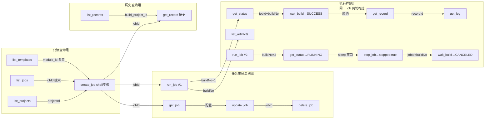

# CodeArtsBuild 插件 — Layer 2 测试场景设计（全工具实调）

> **文档编号**: CAB-DESIGN-006
> **版本**: v0.3.0（迭代由用户决定）
> **日期**: 2026-09-21
> **状态**: 已实施（2026-09-21 实调 22/22 通过）
> **上游依赖**: api-contract.md（§2 工具契约 + §8 实调用确认）、tool-details.md（§2/§3 handler 设计）、template-validation-suite.md（§7.3 现有 Layer 2 流程，聚焦 create_job）
> **对齐依据**: metaRepo YAML（`~/.hcloud/metaRepo/template/codeartsbuild/*.yaml`，2026-09-16 实测）+ openapi.yaml（docs/example）+ 自建 HTTP 承载（AK/SK 签名，http-migration-plan.md）

## 修订记录

| 版本 | 日期 | 说明 |
|------|------|------|
| v0.1.0 | 2026-09-21 | 初始方案：21 场景 5 阶段，执行控制组用真实 Maven 构建 |
| v0.2.0 | 2026-09-21 | **用户评审调整**：① 阶段 3 改用 shell 命令步骤（`20017` + `sleep 10`）替代真实 Maven 构建，构建时长 3~10min→~1min；② stop_job 借 sleep 窗口改为**强断言**（第 2 轮构建停止→CANCELED 链）；③ **暂缓阶段 5（L2-E repo_build 本地组）**；场景数 21→22 执行 + 2 暂缓 |
| v0.3.0 | 2026-09-21 | **实施 + 实调补正**：`scripts/run-layer2-all.js` 落地，22/22 通过；修复 4 缺陷（GET query 签名 401 / wait_build maxRetries=0 / stop 后 completed+取消类error 映射 / 轮询网络抖动终止）；契约补正（`SCHEDULING`→QUEUED、任务不存在 422→E_PARAM、L2-D1 records=0 观察） |
| v0.4.0 | 2026-09-21 | **实测补正续 + 评审修正**：① wait_build 误判 FAILED（workflow.error 瞬态，日志 SUCCESS 但 error 有值）→ record-info 复核；② `SCHEDULED` 排队态第二变体；③ **项目相关值入参确定**（scm 仓库 / build_project_id 改 env 传入 + 动态探测，不硬编码真实值，敏感值不入库） |

---

## 0. 文档定位

**本文件回答"16 个工具的真实接口测试怎么设计"**，与 `template-validation-suite.md`（待办 #15）互补：

| 项 | template-validation-suite.md | 本文件（layer2-test-suite.md） |
|----|------------------------------|-------------------------------|
| 范围 | 仅 create_job 模板链路（create→readback→delete） | **全部 16 个工具**（含执行控制/产物/日志/本地构建） |
| 目的 | 验证模板/组装器有效性 | 验证**工具层契约一致性**（待办 #10：实现 vs api-contract） |
| 断言 | 回读字段一致 | 每个工具的入参→URL→响应→规范化输出 |
| 执行构建 | 否（不调 run_job） | 是（run_job/wait_build/stop_job，**shell sleep 轻量构建**） |

> **关系**：#15 是本文件的一个子集场景（L2-B 的 create→get→delete）；本文件是**契约一致性测试套**（AGENTS.md 待办 #10 落点）。

---

## 1. 测试目标与范围

### 1.1 验证目标

| 验证维度 | 说明 |
|----------|------|
| **URL 正确性** | 每个工具的 method + path 与契约 §2 一致（对照 metaRepo/openapi 实测） |
| **参数对齐** | query/body 字段名与 openapi 定义一致（含单数 parameter、body build_no 等易错点） |
| **响应解析** | 字段提取（result.job_id / octopus_job_name / build_record_id 等）正确 |
| **状态映射** | 原始状态（STARTED/ABORTED/red/blue/running/completed）→ 统一枚举正确 |
| **依赖链贯通** | projectId→jobId→buildNo→recordId 全链取值正确（契约 §1 主键表） |
| **错误路径** | 任务不存在/参数非法 → 正确错误码（E_API/E_PARAM/E_AUTH） |

### 1.2 不验证范围

| 不验证项 | 原因 |
|----------|------|
| handler 逻辑（校验/规范化） | Layer 1 单测已覆盖（154 用例） |
| 模板默认值有效性 | template-validation-suite.md #15 覆盖 |
| repo_build 本地执行细节 | Layer 1 单测覆盖（spawn mock）；L2-E 组**暂缓**（用户指示） |

### 1.3 前置条件（强约束）

| 前置 | 获取方式 | 说明 |
|------|----------|------|
| 凭据 AK/SK | env `CAB_AK`/`CAB_SK` 或 hcloud config | AK/SK 签名需要（credentialSource 参数） |
| region | env `CAB_REGION`（默认 cn-north-4） | 决定 endpoint |
| **测试项目 ID** | env `CAB_TEST_PROJECT_ID` | 32 位业务 projectId，**缺失拒绝执行**（同 run-layer2.js） |
| **测试项目 scm 仓库** | env `CAB_TEST_SCM_REPO_ID`/`CAB_TEST_SCM_REPO_NAME`/`CAB_TEST_SCM_URL`（**可选**） | shell 任务创建需 scm（run_job 需仓库信息，实测 DEVCB.00030046）。**缺省自动探测**：取同项目已有任务的 scms。**不硬编码**（换人/换项目自动适配） |
| **测试项目 build_project_id** | env `CAB_TEST_BUILD_PROJECT_ID`（**可选**） | 36 位 UUID（list_records 用）。**缺省自动探测**：取同项目任务的 build_project_id。不硬编码 |
| 代理 | `--proxy=http://proxycn2.huawei.com:8080` | 内网访问公网 API |
| 测试仓库 | `--repo=<本地 git 仓库路径>` | 仅 L2-E repo_build 场景需要（**本版本暂缓**） |

> **入参确定原则（2026-09-21 评审）**：测试项目相关值（scm 仓库、build_project_id）**通过入参（env）确定**，换人/换项目后仅需调整 env 或依赖自动探测，**不在脚本中硬编码**（真实值不入库）。

---

## 2. 场景分组与依赖链

### 2.1 全工具场景总表（L2-A ~ L2-E，22 执行 + 2 暂缓）

> 依赖链：`projectId →(create_job) jobId →(run_job) buildNo →(get_record) recordId →(get_log)`
>
> **阶段 3 构建任务约定**：不跑真实 Maven 构建——创建仅含**执行 shell 命令**步骤（`devcloud2018.codeci_action_20017.action`）的任务，command 含 `sleep 10` 提供可停止窗口。

| 场景 ID | 域 | 工具 | 前置数据 | 后置产物 | 强断言 |
|---------|----|------|----------|----------|--------|
| L2-A1 | A.项目感知 | `list_projects` | — | projectId 列表 | 响应含 `projects[]`；`identifier→projectId` 映射存在 |
| L2-A2 | A.项目感知 | `list_jobs` | — | jobId 列表 | 响应含 `jobs[]`；`id→jobId` 映射 |
| L2-A3 | C.编排 | `list_templates` | — | 官方模板列表 | 响应含 `templates[]`；`module_id` 全限定名 |
| L2-B1 | C.编排 | `create_job`（shell 步骤） | projectId | **jobId** | `result.job_id` 非空 32 位 UUID；回读含 `20017` 步骤 |
| L2-B2 | A.感知 | `get_job` | L2-B1 jobId | jobName/steps 配置 | 回读 `job_name`=入参；`arch`=x86-64；steps[0].module_id=`20017` |
| L2-B3 | C.编排 | `update_job` | L2-B1 jobId + get_job 配置 | 更新后 jobId | 回读 job_name 已更新；`updated: true` |
| L2-B4 | C.编排 | `delete_job` | L2-B1 jobId | — | `deleted: true`；**幂等**：重复删 → E_API |
| L2-B5 | C.编排 | `create_job`（非法 module_id） | projectId | — | E_PARAM（Layer 1 已拦，L2 验证 handler 直连不绕） |
| L2-C1 | D.执行 | `run_job`（第 1 次，正常构建） | L2-B1 jobId | **buildNo=1** | `actual_build_number`→buildNo（Number）；`octopus_job_name` |
| L2-C2 | E.监控 | `get_status` | jobId+buildNo=1 | status | `status` ∈ 统一枚举；STARTED→RUNNING 映射 |
| L2-C3 | E.监控 | `wait_build`（正常终态） | jobId+buildNo=1 | 终态 SUCCESS | 终态返回；`status`=SUCCESS（shell sleep 10s 后完成） |
| L2-C4 | E.监控 | `get_record` | jobId+buildNo=1 | **recordId** | `record_id` 非空 36 位 UUID；= build_record_id |
| L2-C5 | F.产物 | `list_artifacts` | jobId+buildNo=1 | artifacts[] | `artifacts` 数组存在（可能为空）；job_id/build_no 回填 |
| L2-C6 | G.诊断 | `get_log` | L2-C4 recordId | 结构化日志 | 解压成功；`structured`/`error_summary` 结构合法 |
| L2-C7 | D.执行 | `run_job`（第 2 次，供停止验证） | L2-B1 jobId | **buildNo=2** | 同上（同 job 内 buildNo 递增） |
| L2-C8 | E.监控 | `get_status` | jobId+buildNo=2 | RUNNING | `status`=RUNNING（sleep 10s 窗口内） |
| L2-C9 | D.执行 | `stop_job`（sleep 期间停止） | jobId+buildNo=2 | — | `stopped: true`（**强断言**，sleep 10s 保证运行中） |
| L2-C10 | E.监控 | `wait_build`（停止后终态） | jobId+buildNo=2 | CANCELED | 终态 `status`=CANCELED（停止 → 取消） |
| L2-D1 | E.监控 | `list_records` | build_project_id（36 位） | records[] | `records[]`；build_no→buildNo 映射 |
| L2-D2 | E.监控 | `get_record`（历史） | jobId+buildNo | recordId | 同 L2-C4（复用 L2-B1 jobId） |
| ~~L2-E1~~ | B.本地 | `repo_build` | — | — | **暂缓**（本版本不执行） |
| ~~L2-E2~~ | B→C | `repo_build`→`create_job` | — | — | **暂缓**（本版本不执行） |
| L2-X1 | 错误路径 | `get_job`（不存在 jobId） | — | — | E_API（任务不存在透传） |
| L2-X2 | 错误路径 | `get_log`（非法 recordId） | — | — | E_PARAM（36 位 UUID 校验，Layer 1 已拦，验证直连） |

> 说明：L2-C1~C10 共用 L2-B1 创建的任务（同一 job 内 buildNo 递增：第 1 次正常跑完验证完整链，第 2 次 sleep 期间停止验证 stop→CANCELED）。

### 2.2 场景依赖图



---

## 3. 执行策略（分阶段 + 降级）

### 3.1 阶段划分（可独立运行）

| 阶段 | 场景 | 说明 | 运行耗时 |
|------|------|------|----------|
| 阶段 1：只读查询 | L2-A1~A3 | 无副作用，先跑验证凭据/连通性 | ~10s |
| 阶段 2：任务生命周期 | L2-B1~B5 | 创建 shell 步骤任务→回读→更新→删除，**不执行构建** | ~30s |
| 阶段 3：执行控制 | L2-C1~C10 | **shell `sleep 10` 轻量构建**（非真实 Maven）：两轮构建——第 1 轮跑完整链（run→wait→record→artifacts→log），第 2 轮验证 stop→CANCELED | ~1min |
| 阶段 4：历史查询 | L2-D1~D2 | 依赖阶段 2/3 的 jobId | ~10s |
| ~~阶段 5：本地构建~~ | ~~L2-E1~E2~~ | **暂缓**（本版本不执行，待后续补充 --repo 仓库后再启用） | — |

> **独立运行**：`node scripts/run-layer2-all.js --stage=1` / `--stage=2` ... ；`--only=L2-C3` 单场景。

### 3.2 失败降级（不阻塞后续场景）

| 失败点 | 处理 |
|--------|------|
| 阶段 1 失败（凭据/连通性） | **中止全部**（凭据不可用，后续无意义） |
| L2-B1 create_job 失败 | 中止阶段 2 全部（无 jobId 依赖） |
| L2-C1 run_job 失败 | 标记 FAIL，跳过 L2-C2~C6（无 buildNo）；L2-C7~C10 停止验证仍可独立尝试 |
| L2-C3 wait_build 超时 | 不 FAIL——按契约 §2.14 超时返回 TIMEOUT（软断言，记录耗时），继续 C4 |
| L2-C9 stop_job 失败 | 标记 FAIL（sleep 10s 窗口内应可停）；记录 `stopped` 值供排查 |

### 3.3 幂等与清理

| 项 | 策略 |
|----|------|
| 任务命名 | `l2test-{场景ID}-{时间戳36进制}`，唯一后缀避免重名 422（run-layer2.js 教训） |
| 清理 | 阶段 2/3 创建的 jobId 在场景结束后 `delete_job`（`--no-cleanup` 保留现场） |
| 幂等重试 | 查询类（list_/get_/wait_）幂等重试 3 次；执行类（create/update/run/stop/delete）重试 1 次 |
| 凭据隔离 | 不写死凭据；测试项目 ID 必须显式传（`CAB_TEST_PROJECT_ID`），不回退生产项目 |

---

## 4. 断言设计

### 4.1 强断言（必通过，失败 → 场景 FAIL）

| 工具 | 强断言 |
|------|--------|
| list_projects | `data.projects` 是数组；首个元素 `projectId` 非空 |
| list_jobs | `data.jobs` 是数组；`jobId` 字段存在 |
| list_templates | `data.templates` 是数组；`steps[0].module_id` 匹配 `^devcloud2018\.codeci_action_\d+\.action$` |
| create_job | `job_id` 匹配 `^[0-9a-z]{32}$` |
| get_job | `jobName` = 入参；`arch` = 入参；`steps` 非空 |
| update_job | `updated === true`；回读 `job_name` = 新值 |
| delete_job | `deleted === true` |
| run_job | `buildNo` 是 number ≥1；`job_id` 非空 |
| get_status | `status` ∈ {QUEUED, RUNNING, SUCCESS, FAILED, ERROR, CANCELED} |
| wait_build | 终态 `status` ∈ {SUCCESS, FAILED, ERROR, CANCELED, COMPLETED} 或 TIMEOUT（软） |
| get_record | `record_id` 匹配 `^[0-9a-z-]{36}$` |
| list_artifacts | `artifacts` 是数组；`job_id`/`build_no` 回填正确 |
| get_log | `record_id` 回填；`byte_size` ≥ 0；`structured` 是数组 |
| stop_job | `stopped === true`（**强断言**——L2-C9 在 shell sleep 10s 窗口内调用，构建必在运行中） |
| list_records | `records` 是数组；`buildNo` 是 number |
| wait_build（停止后） | 终态 `status` = `CANCELED`（L2-C10：停止 → 取消） |
| ~~repo_build~~ | ~~`status` ∈ {SUCCESS, FAILED}；`recommended_steps[].module_id` 在白名单~~（暂缓） |
| ~~repo_build→create_job~~ | ~~用 recommended_steps 作 steps 可创建成功（E2 强断言）~~（暂缓） |

### 4.2 软断言（记录 warning，不阻塞场景结论）

| 场景 | 软断言 | 说明 |
|------|--------|------|
| L2-A2 list_jobs | `total` 与 `jobs.length` 关系 | 分页 total 可能不准（-1） |
| L2-C2 get_status | `start_time`/`end_time` 非空 | 刚启动可能无 end_time |
| L2-C5 list_artifacts | `artifacts.length > 0` | shell 步骤无产物 → 空数组合法 |
| L2-C6 get_log | `error_summary` 非空 | 成功构建 → null；仅失败构建才有 |
| L2-D1 list_records | `total >= 1` | 实测（2026-09-21）：本项目返回 `total=-1, records=0`（build_project_id 用 a5e151e2... 时）——ListRecords 该参数下数据为空，软断言记录 |

### 4.3 状态映射验证点（契约 §4.1，2026-09-21 实调补正）

| 原始状态 | 预期映射 | 验证场景 |
|----------|----------|----------|
| `STARTED` | `RUNNING` | L2-C2 / L2-C8（run 后立即 get_status） |
| `SCHEDULING` / `SCHEDULED` | `QUEUED` | L2-C2 / L2-C8 实测（ShowJobBuildRecordDetail 排队态两变体） |
| `SUCCESS`/`FAILED` | 直映 | L2-C3 wait_build 正常终态 |
| `ABORTED` | `CANCELED` | L2-C10 wait_build（stop 后终态，record-info 侧） |
| `completed` + error=取消类 | `CANCELED` | L2-C10 实测（ShowJobStepStatus 侧：error `COCT.0020003.450` "用户取消任务执行"） |
| `completed` + error=其他 | **record-info 复核** | L2-C3 实测（2026-09-21）：workflow.error 可能**瞬态**（日志 `Finished: SUCCESS` 但 error 有值）→ wait_build 调 ShowJobBuildRecordDetail 复核权威终态 |
| `completed` + error=null | `SUCCESS` | L2-C3 正常终态 |
| `red`/`blue` | `FAILED`/`SUCCESS` | L2-A2 list_jobs |

---

## 5. 场景详细设计（关键场景）

### 5.1 L2-B1 create_job（shell 步骤任务）

> **阶段 3 共用**：L2-B1 创建的任务含唯一构建步骤"执行 shell 命令"（`sleep 10`），供 L2-C 两轮构建复用。

```json
{
  "case_id": "L2-B1",
  "tool": "create_job",
  "input": {
    "arch": "x86-64",
    "jobName": "l2test-b1-{ts}",
    "steps": [
      {
        "module_id": "devcloud2018.codeci_action_20017.action",
        "name": "执行shell命令",
        "properties": { "command": "sleep 10" },
        "enable": true
      }
    ],
    "scms": [],
    "parameters": []
  },
  "expected": {
    "job_id": "^[0-9a-z]{32}$"
  }
}
```

> **module_id 依据**：`20017` = 执行 shell 命令，白名单内（step-index.json 20 条，tool-details.md §3.3）。
> `command: "sleep 10"` 提供 10s 可停止窗口：L2-C8 get_status 在窗口内应见 RUNNING，L2-C9 stop_job 可真实停止。

### 5.2 L2-C 执行控制组（shell sleep 轻量构建链）

**前置**：L2-B1 创建的任务（`--no-cleanup` 或阶段 2 后保留 jobId 文件 `docs/example/l2-test-state.json`）。

**第 1 轮（正常构建 → 验证完整链）**：

```json
{
  "case_id": "L2-C1",
  "tool": "run_job",
  "input": { "jobId": "{L2-B1.job_id}" },
  "expected": { "buildNo": "number >= 1" }
}
```

**第 2 轮（停止验证）**：

```json
{
  "case_id": "L2-C7",
  "tool": "run_job",
  "input": { "jobId": "{L2-B1.job_id}" },
  "expected": { "buildNo": "number >= 2" }
}
```

**链式取值**（状态文件贯穿）：

| 步骤 | 取值来源 | 传给 | 时序要求 |
|------|----------|------|----------|
| L2-C1 run_job #1 | 响应 `buildNo=1` | L2-C2/C3/C4/C5 | — |
| L2-C3 wait_build #1 | 终态 SUCCESS | 记录 | sleep 10s 后自然完成 |
| L2-C4 get_record | 响应 `record_id` | L2-C6 | 构建已终态 |
| L2-C6 get_log | 解压 + 清洗 | 结构化输出 | — |
| L2-C7 run_job #2 | 响应 `buildNo=2` | L2-C8/C9/C10 | 与 #1 间隔可立即触发 |
| L2-C8 get_status #2 | `status=RUNNING` | 记录 | **run 后立即**（sleep 窗口内） |
| L2-C9 stop_job #2 | `stopped:true` | 记录 | **get_status 后立即**（sleep 窗口内） |
| L2-C10 wait_build #2 | `status=CANCELED` | 记录 | stop 后轮询 |

> **构建时长**：shell `sleep 10` 单步构建 ~10s 完成，两轮合计 ~30s（含轮询间隔），远优于真实 Maven 构建（3~10min）。
> **stop 时序窗口**：run_job #2 后 sleep 10s 内调用 stop_job 即保证运行中（L2-C8→L2-C9 连续执行）。
> **wait_build 轮询**：默认 intervalMs=10s、timeoutMs=30min；脚本对 C3/C10 用 `--wait-timeout=120000`（2 分钟）足够。

### 5.3 L2-D1 list_records（36 位 build_project_id）

```json
{
  "case_id": "L2-D1",
  "tool": "list_records",
  "input": {
    "buildProjectId": "{list_jobs 返回的 build_project_id，36 位 UUID}",
    "page": 1,
    "limit": 10
  },
  "expected": { "records": "array", "buildNo": "number" }
}
```

> **关键验证点**：契约 §8 #5——build_project_id 是 **36 位 UUID**（ListJob 返回），非 32 位 project_id。用 32 位 projectId 调用 → 预期 E_PARAM（L2-X3 补验证）。

### 5.4 L2-E repo_build 本地组（**暂缓**）

> **本版本不执行**（用户 2026-09-21 指示）。设计保留，待补充 `--repo` 测试仓库后启用。

```json
{
  "case_id": "L2-E1",
  "tool": "repo_build",
  "input": {
    "repoPath": "{--repo 参数}",
    "repoType": "maven"
  },
  "expected": {
    "status": "SUCCESS | FAILED",
    "recommended_steps[0].module_id": "白名单"
  }
}
```

**L2-E2**：取 E1 的 `recommended_steps` → 作为 create_job.steps 入参 → 断言可创建成功（契约 §2.16 recommendedSteps→create_job.steps 同构映射）。

---

## 6. 报告与验收

### 6.1 报告格式（docs/example/test-report-l2-{timestamp}.md）

```markdown
# Layer 2 全工具实调测试报告 — {timestamp}
## 1. 执行摘要
- 场景总数: 22 执行（L2-E 2 个暂缓）/ 通过: N / 失败: M / 软断言警告: K
- 承载: 自建 HTTP（AK/SK 签名）
- 阶段耗时: 阶段1 Xs / 阶段2 Xs / 阶段3 Xs（shell sleep 构建）...
## 2. 场景矩阵
| 场景 | 工具 | 状态 | 关键取值 | 差异/警告 |
## 3. 依赖链验证
projectId → jobId → buildNo=1/2 → recordId 全链值（证明主键表贯通；含 stop→CANCELED 链）
## 4. 状态映射验证
原始状态 → 统一枚举 对应表（含 CANCELED=stop 后终态）
```

### 6.2 验收标准

| 级别 | 标准 |
|------|------|
| ✅ PASS | 全部强断言通过（软断言警告可接受） |
| ⚠️ PARTIAL | 阶段 1/2 通过，阶段 3 因构建环境（超时/无权限）TIMEOUT/FAIL——记录，不视为契约缺陷 |
| ❌ FAIL | 阶段 1 失败，或 L2-B1/L2-C1/L2-C9 强断言失败 |

### 6.3 实调结论（2026-09-21，22/22 通过）

| # | 发现 | 类型 | 处理 |
|---|------|------|------|
| 1 | **GET 带 query 参数签名 401**：AKSKSigner 的 `CanonicalQueryString` 读 `request.queryParams`，仅传 endpoint（query 在 URL 内）→ 服务端校验不匹配 | 缺陷 | http-client.ts 构造 `queryParams` 传给 signer |
| 2 | **wait_build 报"未知原因"**：`maxRetries: 0` 使 HttpClient 循环 `attempt<=0` 不执行直接抛 | 缺陷 | wait-build.ts 改 `maxRetries: 1` |
| 3 | **stop 后终态 FAILED 而非 CANCELED**：ShowJobStepStatus 对停止构建返回 `completed + error={COCT.0020003.450, "用户取消任务执行"}`，原映射 completed+error 一律 FAILED | 缺陷 | mapWorkflowStatus 识别取消类 error → CANCELED |
| 4 | **轮询单轮网络抖动终止整个 wait_build**：E_NETWORK 直接抛出 | 缺陷 | 连续网络失败 ≤3 轮才抛，单轮抖动继续轮询 |
| 5 | **SCHEDULING / SCHEDULED 排队态**：ShowJobBuildRecordDetail 实测返回 `SCHEDULING`（首跑）与 `SCHEDULED`（后续）两变体 | 契约补正 | mapRecordStatus 增加两变体 → QUEUED |
| 6 | **任务不存在 422 而非 404**：`DEVCB.00031006`，handler 映射 E_PARAM（非 E_API） | 契约补正 | L2-X1 断言修正为 E_PARAM |
| 7 | **L2-D1 ListRecords 返回空**：build_project_id 用时 `total=-1, records=0` | 观察 | 软断言记录；待确认 build_project_id 口径（契约 §8 #5 与实测不符） |
| 8 | **wait_build 误判 FAILED（workflow.error 瞬态）**：日志 `Finished: SUCCESS` + record-info=SUCCESS，但 ShowJobStepStatus 的 completed+error 有值 → 误判 FAILED | 缺陷 | wait_build 对 completed+非取消类 error 调 ShowJobBuildRecordDetail 复核权威终态 |
| 9 | **项目相关值硬编码（评审）**：scm 仓库 / build_project_id 原硬编码真实值，换人/换项目即失效 | 评审修正 | 改为入参确定：env `CAB_TEST_SCM_*` / `CAB_TEST_BUILD_PROJECT_ID` 优先，缺省动态探测（同项目任务） |

---

## 7. 与文档一致性

| 契约/设计条目 | 本设计落实 | 状态 |
|---------------|-----------|------|
| 契约 §2 各工具 URL/参数 | 场景入参/断言对齐 | ✅ |
| 契约 §4 状态枚举映射 | §4.3 映射验证点（含 stop→CANCELED、SCHEDULING/SCHEDULED、wait_build 复核） | ✅ |
| 契约 §8 #5 build_project_id 36 位 | L2-D1 关键验证 | ✅ |
| 契约 §2.16 recommendedSteps 映射 | L2-E2（暂缓，设计保留） | ⏸️ |
| AGENTS 待办 #10 契约一致性测试 | 本文件为落点 + `scripts/run-layer2-all.js` 已实施 | ✅ |
| AGENTS 待办 #15 模板验证套 | L2-B 子集 + 已存在 run-layer2.js | ✅ |
| 用户指示（2026-09-21）：shell 步骤替代真实构建 | L2-C 用 `20017` + `sleep 10`；stop 强断言 | ✅ |
| 用户指示（2026-09-21）：暂缓阶段 5 | L2-E 移出执行范围 | ✅ |
| 用户指示（2026-09-21）：项目相关值入参确定 | §1.3 env `CAB_TEST_SCM_*`/`CAB_TEST_BUILD_PROJECT_ID` + 动态探测，不硬编码 | ✅ |

---

## 8. 实施清单（后续步骤）

- [x] `scripts/run-layer2-all.js`：阶段化执行 + 状态文件（docs/example/l2-test-state.json）+ 报告生成（2026-09-21 实施，22/22 通过）
- [ ] `tests/fixtures/layer2-all/`：22 场景 fixture JSON（input + expected；L2-E 2 个暂缓不入库）
- [x] L2-C 时序控制：run #2 后立即 get_status（sleep 窗口内）→ 立即 stop_job → wait_build 轮询 CANCELED（2026-09-21 验证）
- [ ] 与现有 run-layer2.js 合并演进（共享 HttpClient/断言工具函数）
- [ ] CI 集成（可选：凭据注入后定时跑阶段 1/2）
- [ ] L2-E repo_build 组（暂缓，待 --repo 测试仓库就绪后启用）
