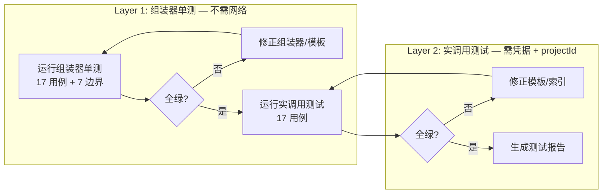
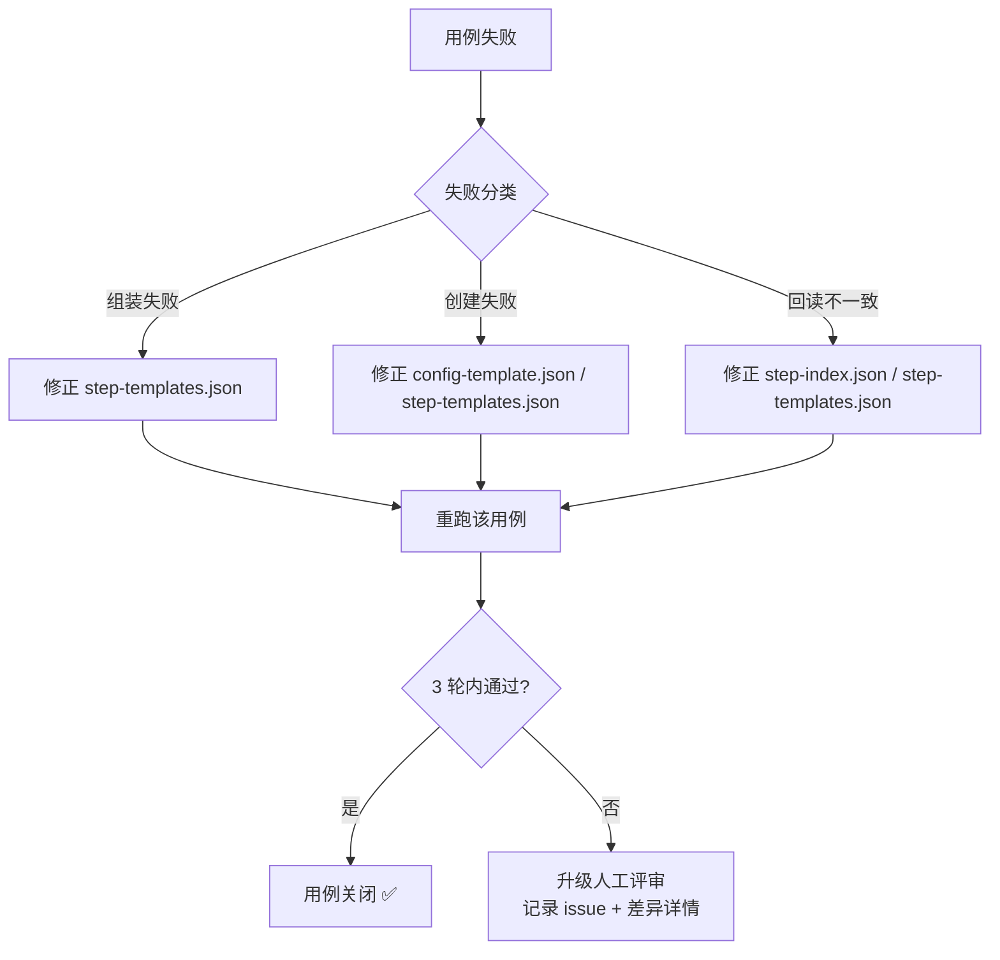
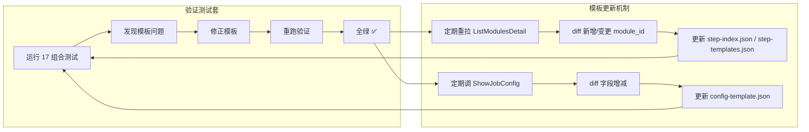

# CodeArtsBuild 插件 — 模板验证测试套件方案

> **文档编号**: CAB-TEST-001
> **版本**: v0.1.0（迭代由用户决定）
> **日期**: 2026-09-18
> **状态**: 待评审
> **上游依赖**: FE-04-Step模板库拆解-20260918.md、api-contract.md、FE-03-工具详细设计-20260918.md、architecture.md
> **数据来源**: step-templates.json（14 模板）、config-template.json（请求骨架）、step-index.json（20 索引）、api-contract.md §2.3/§2.4（create_job/get_job 契约）

## 修订记录

| 版本 | 日期 | 说明 |
|------|------|------|
| v0.1.0 | 2026-09-18 | 初始方案：测试矩阵 17 组合、断言规则 4 类 18 条、分层执行（组装器单测 → 实调用）、失败闭环、覆盖率指标、与 #16 关系 |

---

## 1. 测试目标与范围

### 1.1 验证目标

验证以下三类资产在 `CreateNewJob` → `ShowJobConfig` 全链路中的正确性：

| 资产 | 文件 | 验证内容 |
|------|------|----------|
| Step 模板 | `docs/example/step-templates.json`（14 模板） | 模板 properties 默认值被服务端接受，回读后关键字段一致 |
| Config 模板 | `docs/example/config-template.json`（请求骨架） | 骨架字段（arch/projectId/jobName/steps/scms/parameters/flavor/hostType/buildConfigType 等）被服务端接受 |
| Step 索引 | `docs/example/step-index.json`（20 索引） | `default_properties` 与服务端回读一致；`parameters` schema 的 `required`/`default`/`select` 与服务端行为一致 |
| 组装器 | `src/providers/codeartsbuild/template-assembler.ts`（待实现） | `resolveStep`/`assembleSteps`/`assembleConfig`/`validateSteps` 正确产出 steps[]，module_id 白名单校验生效 |

### 1.2 不验证范围

| 不验证项 | 原因 |
|----------|------|
| 接口封装正确性 | 另有契约一致性测试（api-contract.md 实调用确认，待办 #10） |
| 构建实际执行（run_job/wait_build/stop_job） | 不在 #15 范围；#15 仅验证"创建 + 回读"，不执行构建 |
| 日志清洗（get_log/log-cleaner） | FE-02-日志清洗器规范-20260918.md 另测 |
| update_job/delete_job | 非模板验证核心；delete_job 仅作清理手段 |
| 不维护插件（Ant/Bazel/Grunt 等 16 个） | 用户 2026-09-18 确认不使用，已从 step-index.json 过滤 |

### 1.3 边界

- **仅验证"创建任务 + 回读一致"**：CreateNewJob 成功 → ShowJobConfig 回读 → 断言字段一致 → DeleteTheJob 清理。
- **不执行构建**：不调 ExecuteJob/run_job，不产生 build_no。
- **不验证构建产物**：不调 ShowNewOutput/list_artifacts。

---

## 2. 测试矩阵设计

### 2.1 测试矩阵总表（17 组合）

> 对齐 FE-04-Step模板库拆解-20260918.md §1 语言→推荐步骤组合表。每组合 1 用例，共 17 用例。

| 用例 ID | 语言/场景 | stepsPlan / language | 期望 steps 数 | 涉及 template_id | 涉及 module_id | 关键断言 |
|---------|-----------|----------------------|--------------|-------------------|----------------|----------|
| TV-01 | Java/Maven（jar） | `language: "Java/Maven（jar）"` | 2 | maven-build + upload-release | `20043` + `20018` | module_id 全限定名；image=maven3.5.3-jdk8-open；command 含 mvn package |
| TV-02 | Java/Maven（容器） | `language: "Java/Maven（容器）"` | 2 | maven-build + build-image-swr | `20043` + `20004` | build-image-swr image=docker18.03；imageName/tag 必填占位 |
| TV-03 | Java/Gradle | `language: "Java/Gradle"` | 2 | gradle-build + upload-release | `20008` + `20018` | gradle/jdk 选择字段结构 |
| TV-04 | Java/Android | `language: "Java/Android"` | 2 | android-build + upload-release | `20032` + `20018` | gradle/jdk/ndk 选择字段结构 |
| TV-05 | JavaScript/npm | `language: "JavaScript/npm"` | 2 | npm-build + upload-release | `20014` + `20018` | image=nodejs12.7.0；command 含 npm install |
| TV-06 | JavaScript/npm（容器） | `language: "JavaScript/npm（容器）"` | 2 | npm-build + build-image-swr | `20014` + `20004` | 同 TV-05 + TV-02 组合 |
| TV-07 | Python/PyInstaller | `language: "Python/PyInstaller"` | 2 | pyinstaller-build + upload-release | `20015` + `20018` | image=python3.6；command 含 pyinstaller |
| TV-08 | Python/其他 | `language: "Python/其他（setuptools 等）"` | 2 | shell-command + upload-release | `20017` + `20018` | image=shell4.2.46-git1.8.3-zip6.00；command 可覆盖 |
| TV-09 | Go | `language: "Go"` | 2 | go-build + upload-release | `20026` + `20018` | image=go-1.10.3；command 含 go build |
| TV-10 | PHP | `language: "PHP"` | 2 | php-build + upload-release | `20037` + `20018` | image=php7.3.3；command 含 composer |
| TV-11 | C/C++/CMake | `language: "C/C++/CMake"` | 2 | cmake-build + upload-release | `20005` + `20018` | image=cmake3.10.1-gcc5.5.0；command 含 cmake |
| TV-12 | C#/MSBuild | `language: "C#/MSBuild"` | 2 | shell-command + upload-release(20022) | `20017` + `20022` | 20022 上传变体；file=archive.zip |
| TV-13 | Scala/sbt | `language: "Scala/sbt"` | 2 | shell-command + upload-release | `20017` + `20018` | 同 TV-08（shell 自定义） |
| TV-14 | 通用/自定义 | `language: "通用/自定义"` | 1 | shell-command | `20017` | 单步；image/command 默认值 |
| TV-15 | 纯镜像 | `language: "纯镜像"` | 1 | build-image-swr | `20004` | 单步；imageName/tag/organization 必填 |
| TV-16 | 产物传 OBS | `language: "产物传 OBS"` | 1 | upload-obs | `20057` | 单步；backetName 必填 |
| TV-17 | 从 OBS 拉取 | `language: "从 OBS 拉取"` | 1 | download-obs | `20063` | 单步；bucketName/objectKey 必填 |

### 2.2 边界场景用例

| 用例 ID | 场景 | 输入 | 期望行为 |
|---------|------|------|----------|
| TV-E01 | stepsPlan 自定义参数覆盖 | `stepsPlan: [{step:"maven-build", properties:{command:"mvn clean package -DskipTests", image:"maven3.5.3-jdk8-open"}}]` | 组装器：command 覆盖默认值；实调用：回读 command=mvn clean package -DskipTests |
| TV-E02 | stepsPlan 多步自定义顺序 | `stepsPlan: [{step:"maven-build"},{step:"unit-report", properties:{file:"target/surefire-reports/TEST-*.xml"}},{step:"upload-release", properties:{file:"target/*.jar", buildVersion:"1.0.0"}}]` | 组装器：3 步顺序保留；实调用：回读 3 步 module_id 顺序一致 |
| TV-E03 | language 未匹配 | `language: "Rust"` | 组装器：E_PARAM，列出可用 language 值 |
| TV-E04 | module_id 非白名单 | `steps: [{module_id:"devcloud2018.codeci_action_99999.action", name:"fake"}]` | 组装器/validateSteps：E_PARAM，提示白名单来源 |
| TV-E05 | stepsPlan step 未匹配模板 | `stepsPlan: [{step:"rust-build"}]` | 组装器：E_PARAM，列出可用 template_id |
| TV-E06 | 三选一皆无 | 无 steps/stepsPlan/language | 组装器：E_PARAM，提示传 steps/stepsPlan/language |
| TV-E07 | steps 显式透传（最高优先） | `steps: [{module_id:"devcloud2018.codeci_action_20043.action", name:"Maven构建", properties:{image:"maven3.5.3-jdk8-open", command:"mvn package", preCondition:"SUCCESS"}, enable:true}]` + `stepsPlan: [{step:"npm-build"}]` | 组装器：使用 steps 忽略 stepsPlan；实调用：回读 20043 |

### 2.3 stepsPlan JSON 示例（关键用例）

**TV-01 Java/Maven（jar）**：

```json
{
  "language": "Java/Maven（jar）"
}
```

等价 stepsPlan：

```json
[
  { "step": "maven-build" },
  { "step": "upload-release" }
]
```

**TV-E01 stepsPlan 自定义参数覆盖**：

```json
[
  { "step": "maven-build", "properties": { "command": "mvn clean package -DskipTests", "image": "maven3.5.3-jdk8-open" } },
  { "step": "upload-release", "properties": { "file": "target/*.jar", "buildVersion": "1.0.0" } }
]
```

**TV-E02 多步自定义顺序**：

```json
[
  { "step": "maven-build" },
  { "step": "unit-report", "properties": { "file": "target/surefire-reports/TEST-*.xml" } },
  { "step": "upload-release", "properties": { "file": "target/*.jar", "buildVersion": "1.0.0" } }
]
```

**TV-15 纯镜像**：

```json
{
  "language": "纯镜像"
}
```

等价 stepsPlan：

```json
[
  { "step": "build-image-swr", "properties": { "imageName": "tplval-test", "tag": "v1.0", "organization": "test-org" } }
]
```

---

## 3. 验证流程（每用例）

### 3.1 流程图

```mermaid
flowchart TD
    A[① 组装器单测<br/>stepsPlan/language → steps[]] -->|结构 + 白名单 + 默认值| P{通过?}
    P -->|否| F1[记录组装失败<br/>修正 step-templates.json]
    P -->|是| B[② CreateNewJob 实调用<br/>arch + projectId + jobName + steps]
    B -->|HTTP POST /v1/job/create| Q{result.job_id 非空?}
    Q -->|否| F2[记录创建失败<br/>修正 config-template.json 或 step-templates.json]
    Q -->|是| C[③ ShowJobConfig 实调用<br/>GET /v1/job/{job_id}/config]
    C --> R{回读一致?}
    R -->|否| F3[记录字段差异<br/>修正 step-index.json 或 step-templates.json]
    R -->|是| D[④ 清理 DeleteTheJob]
    D --> E[用例通过 ✅]
    F1 --> G[修正后重跑<br/>3 轮未过 → 人工评审]
    F2 --> G
    F3 --> G
```

### 3.2 步骤详解

**① 组装器单测（不需网络）**

```
输入: stepsPlan 或 language
操作: 调用 assembleSteps() + assembleConfig() + validateSteps()
断言:
  - steps[].module_id 为全限定名（devcloud2018.codeci_action_XXXXX.action）
  - steps[].module_id 在白名单内（FE-03-工具详细设计-20260918.md §3.3）
  - steps[].name 非空
  - steps[].enable = true
  - steps[].properties.preCondition = "SUCCESS"
  - steps 数量与 §1 组合表一致
  - 默认 properties 与 step-templates.json 一致
```

**② CreateNewJob 实调用（需凭据 + projectId）**

```
输入: arch="x86-64", projectId="{测试项目}", jobName="tplval-{组合标识}-{时间戳}", steps=组装后 steps[]
操作: HttpClient POST /v1/job/create（AK/SK 签名，body=组装后请求体）
断言:
  - result.job_id 非空（32 位 UUID）
  - status = "success"
  - error = null
```

**③ ShowJobConfig 回读（实调用）**

```
输入: jobId = ② 返回的 job_id
操作: HttpClient GET /v1/job/{job_id}/config（AK/SK 签名）
断言:
  - result.steps[].module_id 与入参一致（全限定名）
  - result.steps[].name 与入参一致
  - result.steps[].properties 关键字段一致（image/command/preCondition）
  - result.arch = "x86-64"
  - result.project_id = 入参 projectId
  - result.job_name = 入参 jobName
  - result.build_config_type = "ACTION"
```

**④ 清理**

```
操作: HttpClient DELETE /v1/job/{job_id}/delete（AK/SK 签名）
断言: status = "success"（清理失败不阻塞用例结论，仅记录 warning）
```

---

## 4. 断言规则设计

### 4.1 强断言（必通过，失败则用例 FAIL）

| # | 断言对象 | 规则 | 适用阶段 |
|---|----------|------|----------|
| S01 | module_id 格式 | 全限定名 `devcloud2018.codeci_action_XXXXX.action` | 组装器 + 回读 |
| S02 | module_id 白名单 | 在 FE-03-工具详细设计-20260918.md §3.3 白名单内（20 条 step-index） | 组装器 |
| S03 | steps 数量 | 与 §1 组合表期望 steps 数一致 | 组装器 |
| S04 | steps 顺序 | stepsPlan 数组顺序即构建步骤顺序 | 组装器 |
| S05 | name 非空 | `steps[].name` 非空字符串 | 组装器 + 回读 |
| S06 | enable | `steps[].enable = true` | 组装器 + 回读 |
| S07 | preCondition | `steps[].properties.preCondition = "SUCCESS"` | 组装器 + 回读 |
| S08 | image 在可选值清单 | `steps[].properties.image` 在 FE-04-Step模板库拆解-20260918.md §4 对应插件的 image select 数组内 | 组装器 |
| S09 | CreateNewJob 成功 | `result.job_id` 非空 + `status = "success"` | 实调用 |
| S10 | ShowJobConfig 回读 module_id | 回读 `result.steps[].module_id` 与入参完全一致 | 实调用 |

### 4.2 弱断言（记录差异，不导致 FAIL）

| # | 断言对象 | 规则 | 适用阶段 |
|---|----------|------|----------|
| W01 | 默认 command 一致 | 回读 `properties.command` 与 step-templates.json 默认值一致 | 回读 |
| W02 | 默认 image 一致 | 回读 `properties.image` 与 step-templates.json 默认值一致 | 回读 |
| W03 | 非核心 properties 字段 | 回读 properties 含 step-templates.json 中定义的字段（允许服务端补充额外字段） | 回读 |
| W04 | arch 一致 | 回读 `result.arch = "x86-64"` | 回读 |
| W05 | build_config_type 一致 | 回读 `result.build_config_type = "ACTION"` | 回读 |
| W06 | host_type 一致 | 回读 `result.host_type`（devcloud 或 custom_host，允许服务端默认值） | 回读 |

### 4.3 字段命名映射（CreateNewJob camelCase ↔ ShowJobConfig snake_case）

> CreateNewJob 请求体用 camelCase（config-template.json），ShowJobConfig 响应用 snake_case（job_config.json 实测）。断言时需做命名转换。

| CreateNewJob 入参（camelCase） | ShowJobConfig 回读（snake_case） | 断言方式 |
|-------------------------------|----------------------------------|----------|
| `projectId` | `project_id` | 回读 `result.project_id` == 入参 `projectId` |
| `jobName` | `job_name` | 回读 `result.job_name` == 入参 `jobName` |
| `hostType` | `host_type` | 回读 `result.host_type` == 入参 `hostType`（弱断言） |
| `buildConfigType` | `build_config_type` | 回读 `result.build_config_type` == 入参 `buildConfigType` |
| `sourceCode` | `source_code` | 回读 `result.source_code` == 入参 `sourceCode` |
| `buildIfCodeUpdated` | `build_if_code_updated` | 回读 `result.build_if_code_updated` == 入参 `buildIfCodeUpdated` |
| `autoUpdateSubModule` | `auto_update_sub_module` | 回读 `result.auto_update_sub_module` == 入参 `autoUpdateSubModule` |
| `steps[].module_id` | `steps[].module_id` | **无转换**（全限定名，两侧一致） |
| `steps[].name` | `steps[].name` | **无转换** |
| `steps[].properties` | `steps[].properties` | **无转换**（properties 内字段两侧一致） |
| `steps[].enable` | `steps[].enable` | **无转换** |

### 4.4 image 可选值校验清单（S08 依据）

| module_id | 默认 image（加粗） | 可选值（FE-04-Step模板库拆解-20260918.md §4） |
|-----------|-------------------|-------------------------------|
| `20043` Maven | **maven3.5.3-jdk8-open** | maven3.5.3-jdk8-open / jdk7 / jdk10 / jdk11 / jdk17×2 / jdk21 / jdk25 等 10 个 |
| `20014` npm | **nodejs12.7.0** | nodejs8.11.2 / 10.1.0 / 10.15.3 / 12.7.0 / 13~24 等 13 个 |
| `20015` PyInstaller | **python3.6** | python2.7 / 3.5 / 3.6 / 3.7~3.12 等 9 个 |
| `20026` Go | **go-1.10.3** | go-1.10.3 / 1.11.6~1.26 等 15 个 |
| `20037` PHP | **php7.3.3** | php5.6.40 / 7.3.3 / 7.4.33 / 8.0.30 / 8.2 / 8.4 |
| `20005` CMake | **cmake3.10.1-gcc5.5.0** | cmake2.8.12~3.26.5 等 12 个 |
| `20017` Shell | **shell4.2.46-git1.8.3-zip6.00** | shell4.2.46-git1.8.3-zip6.00（单一） |
| `20004` Docker | **docker18.03** | docker18.03 / docker20.10 / docker29.10 |

---

## 5. 测试数据管理

### 5.1 jobName 命名规约

```
tplval-{组合标识}-{时间戳}
```

| 用例 ID | 组合标识 | jobName 示例 |
|---------|---------|-------------|
| TV-01 | maven-jar | `tplval-maven-jar-20260918` |
| TV-02 | maven-container | `tplval-maven-container-20260918` |
| TV-05 | npm | `tplval-npm-20260918` |
| TV-09 | go | `tplval-go-20260918` |
| TV-15 | pure-image | `tplval-pure-image-20260918` |
| TV-16 | upload-obs | `tplval-upload-obs-20260918` |
| TV-E01 | custom-maven | `tplval-custom-maven-20260918` |

> 时间戳精确到日（`YYYYMMDD`），同日多次运行追加序号（`-01`、`-02`）。

### 5.2 测试 projectId

- 使用**专用测试项目**（避免污染生产项目）。
- projectId 通过环境变量 `CAB_TEST_PROJECT_ID` 注入。
- 缺失时报错退出，不回退到生产项目。

### 5.3 清理策略

| 策略 | 说明 |
|------|------|
| 即时清理 | 每用例 ShowJobConfig 断言完成后立即调 DeleteTheJob |
| 批量清理 | 测试结束后执行清理脚本，扫描 `tplval-*` 前缀的任务并删除（兜底） |
| 清理失败 | 不阻塞用例结论，仅记录 warning（`cleanup_failed: {jobId}`） |

### 5.4 测试 Fixtures

测试输入存 `docs/example/test-cases/` 目录：

```
docs/example/test-cases/
├── TV-01-maven-jar.json          # language + 期望 steps
├── TV-02-maven-container.json
├── TV-05-npm.json
├── TV-09-go.json
├── TV-15-pure-image.json
├── TV-16-upload-obs.json
├── TV-17-download-obs.json
├── TV-E01-custom-maven.json      # stepsPlan 自定义参数
├── TV-E02-multi-step.json        # 多步自定义顺序
├── TV-E03-lang-unmatched.json    # 边界：language 未匹配
├── TV-E04-invalid-module-id.json # 边界：module_id 非白名单
├── TV-E05-step-unmatched.json    # 边界：step 未匹配模板
├── TV-E06-no-input.json          # 边界：三选一皆无
└── TV-E07-steps-passthrough.json # 边界：steps 显式透传
```

Fixture 结构（以 TV-01 为例）：

```json
{
  "case_id": "TV-01",
  "name": "Java/Maven（jar）",
  "input": {
    "language": "Java/Maven（jar）"
  },
  "expected": {
    "steps_count": 2,
    "steps": [
      {
        "module_id": "devcloud2018.codeci_action_20043.action",
        "name": "Maven构建",
        "properties_contains": { "image": "maven3.5.3-jdk8-open", "preCondition": "SUCCESS" }
      },
      {
        "module_id": "devcloud2018.codeci_action_20018.action",
        "name": "上传软件包到软件发布库",
        "properties_contains": { "preCondition": "SUCCESS" }
      }
    ]
  }
}
```

---

## 6. 执行方式

### 6.1 分层执行



### 6.2 单次运行（手动触发）

```bash
# 前置：凭据已配置（CAB_AK/CAB_SK，或 hcloud config）+ CAB_TEST_PROJECT_ID 已设置
export CAB_TEST_PROJECT_ID="a287e712be6c404ca26e5f69040fa12b"

# Layer 1: 组装器单测（不需网络）
node scripts/run-template-tests.js --layer=1

# Layer 2: 实调用测试（需网络 + 凭据，HTTP 承载）
node scripts/run-template-tests.js --layer=2

# 全量
node scripts/run-template-tests.js --layer=all
```

### 6.3 持续集成（可选）

| 项 | 说明 |
|----|------|
| 触发 | 定时（每周）或模板更新后手动触发 |
| 凭据 | AK/SK 注入 CI 环境（CAB_AK/CAB_SK 或 hcloud config） |
| projectId | CI 环境变量 `CAB_TEST_PROJECT_ID` |
| 失败通知 | CI 产出报告 + 邮件通知 |
| 限制 | 实调用测试产生真实资源（构建任务），CI 需确保即时清理 |

### 6.4 测试报告

产出路径：`docs/example/test-report-{时间戳}.md`

报告结构：

```markdown
# 模板验证测试报告 — {时间戳}

## 1. 执行摘要
- 总用例数: 24（17 组合 + 7 边界）
- 通过: N / 失败: M / 跳过: K
- Layer 1 通过率: X%
- Layer 2 通过率: Y%

## 2. 用例矩阵
| 用例 ID | 组合 | Layer 1 | Layer 2 | 差异字段 | 状态 |
|---------|------|---------|---------|---------|------|
| TV-01 | Java/Maven（jar） | ✅ | ✅ | — | PASS |
| TV-02 | Java/Maven（容器） | ✅ | ❌ | image 回读缺失 | FAIL |
| ... |

## 3. 字段差异表（失败用例）
| 用例 ID | 步骤 | 字段 | 入参值 | 回读值 | 差异类型 |
|---------|------|------|--------|--------|---------|
| TV-02 | build-image-swr | organization | test-org | (空) | 缺失 |

## 4. 覆盖率指标
（见 §9）

## 5. 模板修正记录
| 用例 ID | 修正文件 | 修正内容 | 修正后状态 |
|---------|---------|---------|-----------|
| TV-02 | step-templates.json | build-image-swr 补 organization 默认值 | PASS |
```

---

## 7. 组装器单测 vs 实调用测试分离

### 7.1 分离原则

| 维度 | 组装器单测（Layer 1） | 实调用测试（Layer 2） |
|------|----------------------|----------------------|
| 依赖 | 无网络，无凭据 | 凭据 + projectId + 网络 |
| 输入 | stepsPlan / language / steps | 组装器产出 + arch + projectId + jobName |
| 输出 | steps[] 结构断言 | result.job_id + 回读字段断言 |
| 速度 | 毫秒级 | 秒级（每用例 2~5s HTTP 往返） |
| 副作用 | 无 | 创建真实构建任务（需清理） |
| 先决条件 | 无 | Layer 1 全绿 |
| 覆盖范围 | 17 组合 + 7 边界 = 24 用例 | 17 组合（边界场景中仅 TV-E07 有实调用价值） |

### 7.2 组装器单测用例清单

| 用例 ID | 测试目标 | 输入 | 断言 |
|---------|---------|------|------|
| TV-01 ~ TV-17 | 17 组合组装正确性 | language 速选 | steps 结构 + module_id 白名单 + 默认值 |
| TV-E01 | stepsPlan 参数覆盖 | stepsPlan + properties 覆盖 | 覆盖值生效 + 未覆盖值保持默认 |
| TV-E02 | 多步自定义顺序 | stepsPlan 3 步 | 顺序保留 + module_id 正确 |
| TV-E03 | language 未匹配 | `language: "Rust"` | E_PARAM + 可用值列表 |
| TV-E04 | module_id 非白名单 | steps 含非法 module_id | validateSteps → E_PARAM |
| TV-E05 | step 未匹配模板 | stepsPlan step="rust-build" | resolveStep → E_PARAM |
| TV-E06 | 三选一皆无 | 无 steps/stepsPlan/language | E_PARAM |
| TV-E07 | steps 透传优先 | steps + stepsPlan 同时传 | 使用 steps 忽略 stepsPlan |

### 7.3 实调用测试用例清单

| 用例 ID | 测试目标 | 实调用操作 |
|---------|---------|-----------|
| TV-01 ~ TV-17 | 17 组合创建 + 回读一致 | CreateNewJob → ShowJobConfig → DeleteTheJob |
| TV-E01 | 自定义参数创建 + 回读 | CreateNewJob（覆盖 command）→ ShowJobConfig 断言 command 覆盖值 |
| TV-E07 | steps 透传创建 + 回读 | CreateNewJob（显式 steps）→ ShowJobConfig 断言 module_id 一致 |

> TV-E02~E06 为纯组装器边界，不执行实调用（无实调用价值——E03/E04/E05/E06 在组装阶段就拒绝，无法创建任务）。

---

## 8. 失败场景与模板修正闭环

### 8.1 失败分类与修正路径

| 失败阶段 | 失败类型 | 根因 | 修正文件 | 修正方式 |
|----------|---------|------|----------|---------|
| ① 组装器 | module_id 非白名单 | step-templates.json 引用了不在 step-index.json 的 module_id | step-templates.json | 修正 module_id 为白名单值 |
| ① 组装器 | 模板未匹配 | stepsPlan.step 引用了不存在的 template_id | step-templates.json | 补充模板或修正 template_id |
| ① 组装器 | 默认值缺失 | 模板 properties 缺必填参数 | step-templates.json | 补充必填参数默认值 |
| ② CreateNewJob | 服务端拒绝字段 | config-template.json 含服务端不接受字段 | config-template.json | 移除多余字段 |
| ② CreateNewJob | 必填缺失 | 服务端要求字段未在 config-template.json | config-template.json | 补充必填字段 |
| ② CreateNewJob | properties 被拒 | step-templates.json 默认值被服务端拒绝 | step-templates.json | 修正默认值 |
| ③ ShowJobConfig | module_id 不一致 | 回读 module_id 与入参不一致 | — | 记录为服务端行为（可能正常） |
| ③ ShowJobConfig | properties 字段缺失 | 回读 properties 缺少模板定义字段 | step-index.json | 修正 default_properties |
| ③ ShowJobConfig | 值漂移 | 回读值与模板默认值不一致 | step-templates.json 或 step-index.json | 修正默认值对齐服务端实际 |

### 8.2 修正闭环流程



### 8.3 升级规则

- 每个失败用例最多自动重跑 **3 轮**（每轮含修正 + 重跑）。
- 3 轮未过 → 升级人工评审，记录：
  - 用例 ID + 失败阶段 + 差异详情
  - 已尝试的修正方案
  - 建议下一步（可能需更新 step-index.json 的 parameters schema 或联系平台侧确认字段变更）

---

## 9. 覆盖率指标

### 9.1 指标定义

| 指标 | 计算方式 | 目标 |
|------|---------|------|
| 组合覆盖率 | (通过组合数 / 17) × 100% | ≥ 94%（允许 1 组合因平台限制失败） |
| 模板覆盖率 | (step-templates.json 14 模板中被引用次数 ≥ 1 的模板数 / 14) × 100% | 100% |
| 必填字段覆盖率 | (§4 权威清单必填项中已验证数 / 必填项总数) × 100% | ≥ 90% |
| 组装器边界覆盖 | (通过的边界用例数 / 7) × 100% | 100% |
| 回读一致率 | (回读一致字段数 / 断言字段总数) × 100% | ≥ 95% |

### 9.2 模板覆盖率预期

| template_id | 被引用用例 | 覆盖状态 |
|-------------|-----------|---------|
| maven-build | TV-01, TV-02, TV-E01, TV-E02, TV-E07 | ✅ |
| upload-release | TV-01, TV-03, TV-04, TV-05, TV-07, TV-08, TV-09, TV-10, TV-11, TV-13, TV-E01, TV-E02 | ✅ |
| build-image-swr | TV-02, TV-06, TV-15 | ✅ |
| gradle-build | TV-03 | ✅ |
| android-build | TV-04 | ✅ |
| npm-build | TV-05, TV-06 | ✅ |
| pyinstaller-build | TV-07 | ✅ |
| shell-command | TV-08, TV-12, TV-13, TV-14 | ✅ |
| go-build | TV-09 | ✅ |
| php-build | TV-10 | ✅ |
| cmake-build | TV-11 | ✅ |
| upload-obs | TV-16 | ✅ |
| download-obs | TV-17 | ✅ |
| unit-report | TV-E02 | ✅ |

> 14 模板全部被引用，模板覆盖率目标 100%。

### 9.3 必填字段覆盖预期

| module_id | 必填字段 | 验证用例 |
|-----------|---------|---------|
| 20043 Maven | image, command | TV-01, TV-02 |
| 20004 Docker | image, registryUrl, organization, imageName, tag | TV-02, TV-15 |
| 20017 Shell | image, command | TV-08, TV-12, TV-13, TV-14 |
| 20014 npm | image, command | TV-05, TV-06 |
| 20026 Go | image, command | TV-09 |
| 20015 PyInstaller | image, command | TV-07 |
| 20037 PHP | image, command | TV-10 |
| 20005 CMake | image, command | TV-11 |
| 20018 上传软件包 | file | TV-01, TV-03~TV-11, TV-13 |
| 20057 上传 OBS | backetName | TV-16 |
| 20063 下载 OBS | bucketName, objectKey | TV-17 |
| 20008 Gradle | gradle, jdk | TV-03 |
| 20032 Android | gradle, jdk, ndk | TV-04 |
| 20022 上传(Windows) | file | TV-12 |
| 20071 单元测试报告 | unit_type, file | TV-E02 |

---

## 10. 与 #16 模板更新机制的关系

### 10.1 闭环关系



### 10.2 联动规则

| 事件 | #15 动作 | #16 动作 |
|------|---------|---------|
| #15 发现模板问题 | 修正 + 重跑 | — |
| #15 全绿 | — | 触发定期检查（#16 重拉 ListModulesDetail diff） |
| #16 发现新增 module_id | — | 更新 step-index.json → 触发 #15 新增用例 |
| #16 发现字段变更 | — | 更新 step-templates.json → 触发 #15 重跑受影响用例 |
| #16 发现 image 可选值变更 | — | 更新 step-index.json parameters.select → 触发 #15 重跑 S08 断言 |

### 10.3 #16 更新触发 #15 重跑的范围

| #16 变更类型 | #15 重跑范围 |
|-------------|-------------|
| 新增 module_id（新插件） | 全量 17 组合 + 受影响新组合 |
| module_id 下线（不维护） | 受影响组合（改为 shell 替代后重跑） |
| image 可选值变更 | 受影响插件覆盖的用例 |
| 必填字段变更 | 受影响插件的用例 |
| config-template 字段变更 | 全量 17 组合（config 骨架变更影响所有用例） |

---

## 11. 与契约一致性核对

> 本方案与 api-contract.md v0.5.2、FE-03-工具详细设计-20260918.md v0.3.0、FE-04-Step模板库拆解-20260918.md v0.7.2 的一致性核对。

| 核对项 | 本方案 | 契约/详细设计 | 一致? |
|--------|--------|-------------|-------|
| CreateNewJob URL | `/v1/job/create` | api-contract §2.4: `/v1/job/create` | ✅ |
| ShowJobConfig URL | `/v1/job/{job_id}/config` | api-contract §2.3: `/v1/job/{job_id}/config` | ✅ |
| DeleteTheJob URL | `/v1/job/{id}/delete` (HTTP DELETE) | api-contract §1.4.1: `DeleteTheJob`（`/v1/job/{id}/delete`） | ✅ |
| arch 枚举 | `x86-64` | api-contract §2.4: `x86-64` / `arm` | ✅ |
| module_id 全限定名 | `devcloud2018.codeci_action_XXXXX.action` | api-contract §2.4 + tool-details §3.3: 全限定名 | ✅ |
| module_id 白名单来源 | step-index.json 20 条 | tool-details §3.3: 三来源（recommended_steps / list_templates / 白名单） | ✅ |
| stepsPlan 结构 | `[{step, properties?}]` | api-contract §2.4 + tool-details §3.4: 同构 | ✅ |
| steps 优先级 | steps > stepsPlan > language | tool-details §3.4: 同 | ✅ |
| assembleConfig 字段 | arch/projectId/jobName/steps/scms/parameters/flavor/hostType/buildConfigType | config-template.json + api-contract §2.4 | ✅ |
| camelCase ↔ snake_case 映射 | 见 §4.3 | api-contract §1.2: JSON 输出 camelCase，接口原始 snake_case | ✅ |
| language 组合值 | §2.1 表 17 组合 | step-templates §1: 17 组合 | ✅ |
| step-templates.json 模板数 | 14 | step-templates §7.2: 14 | ✅ |
| step-index.json 索引数 | 20 | step-templates §7.1: 20（过滤 16 不维护） | ✅ |
| 不维护插件排除 | 不测试 | step-templates §1 + tool-details §3.3: 16 个不维护 | ✅ |
| v3/v4 禁用 | 仅用 v1 接口 | api-contract §1.4: v3/v4 一律禁用 | ✅ |

---

## 12. 后续工作

| # | 事项 | 依赖 | 状态 |
|---|------|------|------|
| 1 | 实现 `template-assembler.ts`（组装器） | 本方案通过评审 | ⏳ 待办 |
| 2 | 编写组装器单测（Layer 1，24 用例） | #1 完成 | ⏳ 待办 |
| 3 | 编写实调用测试脚本（Layer 2，17+2 用例） | #2 全绿 + 凭据配置 | ⏳ 待办 |
| 4 | 创建测试 Fixtures（`docs/example/test-cases/*.json`） | 本方案通过评审 | ⏳ 待办 |
| 5 | 首次全量运行 + 生成报告 | #3 + #4 | ⏳ 待办 |
| 6 | 根据报告修正模板（step-templates.json / config-template.json / step-index.json） | #5 完成 | ⏳ 待办 |
| 7 | 接入 #16 模板更新机制 | #6 全绿 | ⏳ 待办 |
