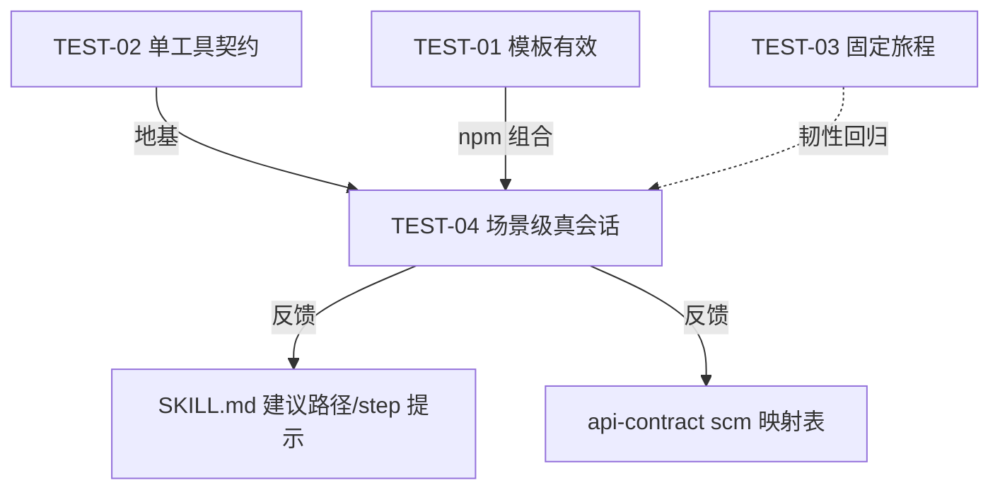

# CodeArtsBuild 插件 — 场景集成测试设计（真实 dsh 会话完整构建链路）

> **文档编号**: CAB-TEST-004
> **版本**: v0.5.0（迭代由用户决定）
> **日期**: 2026-10-09
> **状态**: 待评审
> **上游依赖**: prd.md §2（用户故事）、api-contract.md（§2 工具契约 + §8 实调用确认）、SKILL.md（LLM 编排依据）、TEST-01~03（CAB-TEST-001~003）、FE-07（模板环境锚点/scm 来源强制）、FE-08（CodeArtsRepo 接口实测 + repo_prepare 形态 §5/§7 + scm 字段映射 §1.5）
> **对齐基线**: 2026-09-21 人工测试轨迹（`docs/临时文件.md` 观察结论）——本文件的 4 场景是对轨迹缺陷的定点纠偏

## 修订记录

| 版本 | 日期 | 说明 |
|------|------|------|
| v0.1.0 | 2026-09-22 | 初始方案：4 真实场景（S1~S4）+ 链路符合性清单 + 执行示例 |
| v0.2.0 | 2026-09-23 | 对齐 FE-07/FE-08：补 repo_push 仓库准备链路、scm 映射表实测落定、list_templates 改查用户自定义模板 |
| v0.3.0 | 2026-09-28 | 对齐 FE-08 §7：repo_push 改名 repo_prepare（push 由模型自探索）；S1 补模型 push 环节 |
| v0.4.0 | 2026-09-28 | **对齐现状 + 精简**：修复版本/用例数一致性；S1 明确 push 失败不阻断判定；S2 补 scm 来源渠道（无独立 get_repo 工具）；S4 补失败任务构造前置（衔接 TEST-02 shell sleep+exit 1）；§6 补统一执行入口；删过程记录（人工轨迹章/业界引用堆砌/过时待办） |
| v0.5.0 | 2026-09-28 | **对齐 FE-09**：S1 检查点强化——repo_prepare.repo_id 必须存在（已有远端也回读）/ repo_id:null 时禁止 URL 当 repo_id / create_job 同一错误 ≤3 轮转人工 / 禁止空 scms+agencyUrn 绕过；新增 D1~D5 缺陷回归点 |
| v0.6.0 | 2026-10-09 | **对齐测试可复现性**：① `.dsh-codearts` 升为**必选前置**（环境配置唯一来源，含 AK/SK/region/代理/模型 key）；② 测试过程**关注工具调用链路**（会话解析 SOP 集成）；③ 测试报告补**链路拟合度评分**（实际序列 vs 预期序列）+ **工具调用异常分析**（失败分类/重复失败/异常码） |

---

## 0. 文档定位

本文件回答**"真实 dsh 会话中，模型按 SKILL 规约完成一次完整构建链路怎么验证"**——即模型把 18 个原子工具串成有意图的可执行编排。与 TEST-02/03 互补：

| 项 | TEST-02（单工具契约） | TEST-03（用户故事旅程） | 本文件（场景会话） |
|----|----------------------|-------------------------|--------------------|
| 粒度 | 单工具 22 场景 | 跨工具 8 旅程 | **模型端到端自由编排**（N 场景） |
| 验证点 | URL/参数/响应/映射 | 数据流转衔接 | **选对工具 + 排对序 + 数据源自实测非推测** |
| 执行者 | `run-layer2-all.js` | `run-integration.js` | **`dsh --profile headless` 真实会话** + LLM-as-judge 读轨迹 |
| 判定 | 强断言 | 终态+衔接断言 | **任务成功率 + 序列正确性 + 数据来源合规 + 推理质量** |

> **关键差异**：脚本旅程入参已由测试者填好；真实会话中模型**必须自行 list_projects/list_jobs/list_templates 探测、向用户提问、从已有任务学习 scm 结构、判断模板环境锚点**——这些"情报获取 + 决策"正是场景级测试要覆盖的对象。TEST-04 是前两者的**上层真值检验**。

---

## 1. 验证目标与成功口径

### 1.1 验证目标

| 维度 | 说明 | 场景 |
|------|------|------|
| 编排正确地达成任务 | 工具序列完成"创建/构建/产物"最终目标 | S1/S2 |
| 工具调用序列合规 | 顺序+选择符合 SKILL 建议路径与强制规约 | S1~S4 |
| 数据来源合规（不臆造） | projectId/jobId/buildNo/recordId/scm 来自正确前置渠道 | S1~S4（重点 S2） |
| 模板/环境锚点正确 | 语言→构建环境→模板/步骤组装的判定链路 | S3 |
| 失败诊断闭环 | 失败→取记录→日志→清洗→根因→修复/升级 | S4 |
| 交互与升级 | 不确定处（projectId/delete/字段不明）求助用户，不硬猜 | 全 |

### 1.2 成功口径（多指标，非单一"终态"）

| 指标 | 定义 | 级别 |
|------|------|------|
| T·任务成功率 | 会话达成用户目标的最终产物/终态正确 | 主 |
| T·调用序列正确性 | 顺序与选择符合 SKILL；无缺失前置/冗余空转 | 主 |
| T·工具参数正确性 | 参数值来自正确来源（与工具选择独立打分） | 主 |
| D·数据来源合规 | projectId/scm 等不臆造 | 主 |
| D·效率 | 有效调用占比；重复失败计入负分 | 辅 |
| Q·推理与交互质量 | 判定有据、正确时点求助、失败后自救/升级 | 辅 |
| S·安全性（门禁） | 无注入后门、delete 未确认不执行、密钥不泄露 | 门禁 |

```
✅ 达成 = 主指标全过 + 门禁零违规
⚠️ 部分 = 任务达成但序列/数据来源有瑕疵，或任务未达成但链路合规（链路通，目标未达）
❌ 未达成 = 任务未达成 + 链路不合规（臆造/乱序/绕开前置）
```

> **"会话失败"≠"测试失败"**：scm 字段不明时主动停下向用户确认 → Q 通过；反复用猜测参数硬试 → D/Q/T 记负。

---

## 2. 测试场景设计（S1~S4）

> 环境锚点总则（全部场景通用）：**前端/TS/现代 JS 一律以构建环境为锚点**——构建在 node 环境跑 `npm`/`yarn`/`tsc` 即归 npm 模板（`20014`，image=nodejs12.7.0），**不得因"用 tsc"改选 Shell**。

### 2.1 S1 本地仓库场景（完整闭环）

> 本地无远端：`repo_prepare` 建仓+回读 RepoInfo（**工具不做 push**）→ 模型用宿主命令工具 push → `repo_build` 验证 → create → run → wait → artifacts。

**触发词**：
```
按照这个仓库创建个codeartsbuild构建任务，仓库地址：D:\code\ai\dsh-quant
```

**预期序列**：
```
① Read/Glob 仓库文件             — 判明 Tech（repo_build 前置探测）
② list_projects()                 — 取 projectId（强制规约 #1，不臆造）
③ [可选] 向用户提问选定项目
④ repo_prepare(repoPath, projectUuid)
                                   — 建仓+回读 RepoInfo（repo_id/url/web_url + remote_url/push_guidance）
④' 宿主命令工具（bash/pwsh）执行 git push
                                   — `git remote add origin <remote_url> && git push -u origin <branch>`
⑤ repo_build()                    — 本地构建验证（输出 recommended_steps）
⑥ [可选] list_templates()         — 查用户自定义模板（#23）
⑦ create_job(projectId, jobName, scms=[repo_prepare 返回的 RepoInfo], steps=recommended_steps/language/stepsPlan)
⑧ run_job(jobId) → ⑨ wait_build → ⑩ list_artifacts
⑪ [可选] delete_job（删除前须用户确认，强制规约 #4）
```

**检查点**：
- `repo_prepare.repo_id` **必须存在**（FE-09 P0-A：已有远端也会回读 repo_id）+ `remote_url`/`push_guidance` 已返回；若输出 `repo_id:null` → 模型必须经 `get_job`/`list_jobs` 回读或向用户要 repo_id，**禁止用 URL 当 repo_id**（FE-09 缺陷 D1/D2 回归点）
- **push 判定**：push 由模型执行——**失败不阻断**（仓库已建 + RepoInfo 已可建任务）；模型读 stderr 分类（认证→提示 token/SSH 密钥，网络→提示代理/网络），≤3 轮升级用户（强制规约 #6）。**push 失败（认证/网络）不判缺陷**，归 `runtime`；push 环节缺失（跳过直接建任务且未说明）记 `sequence` 瑕疵
- `repo_build.status === 'SUCCESS'` 且 `recommended_steps[].module_id` 全限定名、与 create_job.steps 同构
- `create_job.job_id` 32 位 UUID；`steps[].module_id` 在实测白名单（npm → `20014`）；`scms` 来自 repo_prepare 返回（scm_type=codehub, repo_id, url=httpUrl, web_url=webUrl）
- **create_job 失败处理（FE-09 P0-B）**：同一错误（422 仓库不存在 / repo_id 必填）**≤3 轮**后必须转人工求助，不得无限改参硬试（D3 回归点）；**禁止**以"空 scms + agencyUrn"绕过（合法但任务无代码源，run_job 无法构建——D4 回归点，除非用户明确确认）
- `run_job.buildNo ≥1`；`wait_build` 终态 SUCCESS；`list_artifacts.artifacts` 数组

**判定**：
- ✅ 任务创建成功 + 可 run + 产物可取 + 检查点全过 + 数据来源合规
- ⚠️ 任务达成但步骤冗余/缺失（如跳过 repo_build 直接 create）；或 push 环节缺失未说明
- ❌ 未先 repo_build/repo_prepare 就 create 且失败后反复硬试；projectId/scm 臆造

### 2.2 S2 远端仓库场景（scm 字段映射 + 本地拉取验证）

> 远端仅支持 CodeArtsRepo（codehub）。两条硬约束：① 优先拉取到本地、本地构建通过后再建任务（用户观察 #5）；② scm 字段必须来自实测映射表，不推测（用户观察 #6）。
>
> **scm 来源渠道（2026-09-28 明确，无独立 get_repo/list_repos 工具）**：当前工具集仅 `repo_prepare` 能产出 RepoInfo（repo_id/url/web_url）——S2 远端仓库的 scm 字段**三选一**：① 用户提供远端仓库 RepoInfo（明确 repo_id/url）；② 经 `repo_prepare` 建仓路径取得（本地 clone 后建仓）；③ 已有任务回读（`get_job`/`list_jobs` scm 结构）。**禁止**从 git clone URL 推测 repo_id。

**触发词**：
```
按照这个仓库创建个codeartsbuild构建任务，仓库地址：https://devcloud.huaweicloud.com/codehub/{projectId}/{repoName}（或 git@codehub.devcloud.huaweicloud.com:{groupId}/{repoName}.git）
```

**预期序列**：
```
① list_projects()                      — 取 projectId（强制规约 #1）
② git clone 远端到本地                 — 模型用宿主命令工具；或向用户确认已配置 codehub 仓库
③ 获取 scm RepoInfo（三选一）
    ├─ 用户提供 repo_id/url             — 明确渠道
    ├─ repo_prepare(本地拉取路径, projectUuid) → 建仓/复用 + 回读 RepoInfo
    └─ get_job/list_jobs 已有任务回读 scm 结构
④ repo_build(本地拉取路径)             — 本地构建通过后再建任务（用户观察 #5）
⑤ create_job(projectId, jobName, scms=[{scm_type:codehub, repo_id, url, web_url}], steps=...)
⑥ run_job → wait_build → list_artifacts（同 S1）
```

**scm 字段映射表（FE-08 §1.5 实测落定，2026-09-23 端到端验证通过）**：

| 字段 | 取值规则（来源） | 轨迹中的错误 |
|------|------------------|-------------|
| `scm_type` | **`codehub`**（实测唯一支持）——gitlab/github/gitee 未实测禁用 | 推测 gitlab/pipeline → 422 |
| `repo_id` | `RepoInfo.repoId`（数字主键），取自 repo_prepare 返回 / 用户提供 / 已有任务回读 | 缺失 → "仓库不存在"422 |
| `repo_name` | `RepoInfo.name` | — |
| `url` | `RepoInfo.httpUrl`（HTTPS 克隆地址） | — |
| `web_url` | `RepoInfo.webUrl` | — |
| `branch` | 目标分支（默认 master） | — |

> `create_job` handler 内置 `validateScms`（FE-07 §2.5 O5）：scm_type 非 codehub / repo_id 缺失 / 第三方 URL 均拦截 E_PARAM；422 增强回溯提示。

**判定**：
- ✅ 本地构建通过后再 create；scm 全字段来自实测映射/用户确认；任务闭环
- ⚠️ 任务成功但 scm 取值有猜测痕迹（回读 diff 后修正）
- ❌ 未带本地构建硬试；scm_type 臆造 → 持续 422 仍不求助用户（归 `data-sourcing` + `interaction` 缺陷）

### 2.3 S3 模板选择场景（TS/前端锚定构建环境选 npm 模板）

> 复刻人工轨迹 #6 裁决点并纠偏（误判：因"用 tsc"改选 Shell）。

**触发词**：
```
这个 TypeScript 项目要用 codeartsbuild 建构建任务，帮我选合适模板并创建。
```

**预期序列 / 检查点**：
```
① Read package.json/tsconfig.json → 判明：构建在 node 环境（npm 生态）
② list_templates()                 — 查用户自定义模板（官方模板不通过本工具查询）
③ 裁决：TS 构建环境与 npm 等价 → npm 模板（20014，image=nodejs12.7.0）
   （不因"用 tsc"改选 Shell 20017；FE-07 §2.1 环境锚点 + SKILL 规约）
④ create_job(language:"JavaScript/npm" 或 stepsPlan:[{step:"npm-build",properties:{command:"npm ci && npm run build"}}] 或 steps=[20014])
⑤ run → wait → artifacts
```

**判定**：
- ✅ 归 npm 模板 + 回读 `20014` module_id + 构建闭环
- ❌ 归 Shell 模板（复刻轨迹错误）；或选无构建步骤的空模板（归 `reasoning` 缺陷，反馈优化 SKILL 提示）

### 2.4 S4 失败诊断场景（失败 → get_record → get_log → 清洗 → 根因）

> 复刻 TEST-03 US-13 / TEST-02 L2-E 失败诊断链，由模型在会话中主动完成"失败识别→取记录→取日志→清洗→根因→修复建议/升级"。
>
> **失败任务构造前置（2026-09-28 明确）**：S4 需要确定性失败任务——复用 TEST-02 方法（experience: shell sleep + exit 1）：先用 `create_job` 建仅含 shell 步骤任务（module_id=`devcloud2018.codeci_action_20017.action`，`properties.command="exit 1"`）并 run 一次产生 FAILED 记录；或复用 S1/S2 已建的失败任务。构造步骤算**测试前置**，不计入 S4 判定序列。

**触发词**：
```
构建失败了，帮我看看 dsh-quant 这个任务为什么失败并给出修复建议。
```

**预期序列 / 检查点**：
```
① list_jobs(搜索 dsh-quant) → jobId（可选）
② get_status / wait_build(jobId, buildNo) → 确认终态 FAILED
③ get_record(jobId, buildNo) → record_id（唯一来源 = get_record，强制规约 #3）
④ get_log(record_id) → 解压 + 清洗（FE-02 规范）
⑤ LLM 分析根因 → 结构化解释 + 修复建议
⑥ 修复后重试 repo_build / run_job | 无果升级用户（≤3 轮，强制规约 #6）
```

**检查点**：`record_id` 仅来自 `get_record`（36 位 UUID）；`get_log` 失败后触发（强制规约 #5）；清洗输出结构化（`structured` 数组 + `error_summary`）、根因可溯源日志；重试 ≥3 轮升级用户。

**判定**：
- ✅ 端到端根因定位 + 可执行建议；或正确识别为环境/无权限并升级
- ⚠️ 根因对但建议空泛未落地
- ❌ 未经 get_record 直接乱调 get_log；越权/无限重试不升级；日志清洗丢关键行

---

## 3. 链路符合性检查清单（过程即产物）

> 不只检查"结果是否达预期"，还检查"过程是否符合链路"。每项违反记相应缺陷（§4 分类）。

### 3.1 数据来源合规（No Fabrication）

| # | 检查点 | 违反示例 | 依据 |
|---|--------|----------|------|
| L1 | create_job 前必有 repo_build（本地）或本地拉取验证（远端） | 直接 create_job 无本地验证 | SKILL 意图 1 |
| L2 | projectId 来自 list_projects / 用户指定（显式>会话>配置>询问） | 会话硬编码 | 强制规约 #1 |
| L3 | scm 字段（scm_type/repo_id 等）来自实测映射表 / repo_prepare 返回 / 用户确认 | gitlab/pipeline → 422 反复 | FE-08 §1.5；O5 |
| L4 | module_id 全限定名且在实测白名单；steps 来源 = recommended_steps / list_templates / stepsPlan/language | 短名/臆造 module_id | create_job 契约 §2.4 |
| L5 | record_id 仅取自 get_record(jobId,buildNo) | 用猜测 id 调 get_log | 强制规约 #3 |
| L6 | delete_job 前向用户确认 | 直接删 | 强制规约 #4 |
| L7 | get_log 按需触发（先判失败/用户要求） | 成功也拉日志 | 强制规约 #5 |

### 3.2 序列与时机

| # | 检查点 | 违反示例 | 依据 |
|---|--------|----------|------|
| L8 | 依赖链顺序合法：projectId→create→jobId→run→buildNo→get_record→recordId→get_log | 未 create 就 run | 依赖链（SKILL） |
| L9 | 查询类先于写操作做情报收集 | 直接 create 凭记忆填参数 | SKILL 建议路径 |
| L10 | jobId+buildNo 配对来自同一构建 | 任务 A buildNo 查任务 B | 强制规约 #2 |
| L11 | 环境锚点正确：TS/前端→npm 模板 | "TS 用 tsc → Shell" | 用户观察 #3 |
| L12 | 失败自救 ≤3 轮，超限升级用户 | 同参数 create 5+ 次 | 强制规约 #6 |

### 3.3 失败分类 → 处置

| 分类 | 含义 | 示例 | 处置 |
|------|------|------|------|
| `sequence` | 顺序/前置缺失 | 未 repo_build 直接 create | 缺陷：指正 + 重跑 |
| `data-sourcing` | 参数臆造/来源错 | scm_type=gitlab 硬试 | 缺陷：指向 §2.2 映射表 + 求助用户 |
| `reasoning` | 判定锚点错 | TS→Shell 模板 | 缺陷 + 反馈 SKILL/step 模板 |
| `compliance` | 违反强制规约 | get_log 未由 get_record 取 record_id | 缺陷 |
| `diagnosis` | 根因误判/建议无效 | 缺依赖说"权限问题" | 记录 + LLM-readable 评估 |
| `escalation` | 超限不升级/越权 | delete 未确认、3 轮+硬试 | 缺陷 |
| `runtime` | 真实环境因素 | 网络/项目权限致构建失败 | **非缺陷**：记录环境原因 |
| `dependency` | 被测对象外依赖 | 远端库拉取失败 | **非缺陷**：记录 |

> 非缺陷类（`runtime`/`dependency`）致"任务未达成"时，链路合规（§3.1/3.2 全过）→ ⚠️ 部分通过。

---

## 4. 执行方式（真实 dsh 会话 + 可验证步骤）

### 4.1 前置条件

| 前置 | 说明 |
|------|------|
| **`.dsh-codearts`（必选，环境配置唯一来源）** | **测试前置条件**：工作目录下 key=value 文件（`credentialSource=file`），包含 `CAB_AK`/`CAB_SK`/`CAB_REGION`/`HTTPS_PROXY`/`XLB_API_KEY`。**测试执行前必须存在**，缺任一项则测试前置不满足、不启动会话。格式与要点见 test-run-reference.md §2.1。 |
| 模型 API Key | 从 `.dsh-codearts` 读 `XLB_API_KEY`（`settings.yaml` 的 `apiKeyEnv: XLB_API_KEY`） |
| 代理 | 从 `.dsh-codearts` 读 `HTTPS_PROXY`（内网访问公网 API；HttpClient 的 proxyUrl 优先级：插件 config > `HTTPS_PROXY` > `HTTP_PROXY`） |
| 凭据 | 从 `.dsh-codearts` 读 `CAB_AK`/`CAB_SK`/`CAB_REGION`——一律占位符写入文档，绝不写真实密钥入文件/脚本/PR |
| 测试仓库 | `D:\code\ai\dsh-quant`（S1/S3）；一个已有 CodeArtsRepo 远端仓库（S2） |
| 项目 | 可用测试项目（模型经 list_projects 选择，如 ZDF_测试凤凰） |
| 失败任务 | S4 前置：shell 步骤 `exit 1` 任务（`20017` module_id）+ 一次 FAILED 运行记录 |
| profile | `--profile headless` + `--patch cordis.patch.yml`（装配插件） |

> **`.dsh-codearts` 前置校验**（执行前）：文件存在 + `CAB_AK`/`CAB_SK`/`CAB_REGION`/`HTTPS_PROXY`/`XLB_API_KEY` 五项非空；AK 20 位大写数字字母、SK 40 位（加密存储会导致签名 401，test-run-reference §2.1）。**缺任一项 → 中止测试并提示补齐**，不启动会话。

### 4.2 统一执行入口（S1）

> 环境配置**全部从 `.dsh-codearts` 读取**（前置条件，见 §4.1），执行命令不再需要命令行 env 注入——凭据/代理/模型 key 由插件自动探测（`credentialSource=file`）+ dsh settings 读取。

```bash
# 前置：工作目录已有 .dsh-codearts（CAB_AK/CAB_SK/CAB_REGION/HTTPS_PROXY/XLB_API_KEY 五项）
cd D:/code/ai/dsh-codeartsbuild
dsh --profile headless --patch cordis.patch.yml \
  "按照这个仓库创建个codeartsbuild构建任务，仓库地址：D:\code\ai\dsh-quant"
```

**此步检查点（对照 §3）**：先 Read/Glob 判明技术栈（L9）→ list_projects 获 projectId（L2）→ repo_prepare + 模型 push → repo_build 再 create（L1）→ create/run/wait/artifacts 按序（L8）→ 依赖链取值配对被用于后续工具（L10）。

### 4.3 场景差异提示词（S2/S3/S4）

```bash
# S2 远端仓库（CodeArtsRepo）——验证 scm 字段映射 + 本地拉取验证
dsh --profile headless --patch cordis.patch.yml \
  "按照这个仓库创建个codeartsbuild构建任务，仓库地址：https://devcloud.huaweicloud.com/codehub/{projectId}/{repoName}"

# S3 模板/环境锚点（TS → npm 模板判定）
dsh --profile headless --patch cordis.patch.yml \
  "这个 TypeScript 项目要用 codeartsbuild 建构建任务，帮我选合适模板并创建。"

# S4 失败诊断（前置：shell exit 1 任务已建并跑过 1 次 FAILED）
dsh --profile headless --patch cordis.patch.yml \
  "构建失败了，帮我看看 dsh-quant 这个任务为什么失败并给出修复建议。"
```

> **执行注意**：所有场景均从插件工作目录启动（`cd D:/code/ai/dsh-codeartsbuild`）——`hasDotDshCodearts()` 依赖 `process.cwd()` 找 `.dsh-codearts`（test-run-reference §4.2），从别的目录启动 file 源不命中。

### 4.4 工具调用链路提取（会话解析 SOP）

> 测试过程**必须关注工具调用链路**——从会话记录解析完整调用流，作为拟合度评分与异常分析的输入。

**提取步骤**（详见 test-run-reference.md §5）：
1. 定位最新会话记录：`C:\Users\<user>\.dsh\sessions\--D-code-ai-dsh-codeartsbuild--\`（按时间倒序 `ls -lt`）
2. 解压：多帧 zstd 拼接流，扫描魔数 `0x28B52FFD` 逐帧解压拼接（Node 24+ 内置 zstd）
3. 提取调用流：`tool/call` 事件（`data.name` + `data.arguments`，按 seq 排序 = 调用序列）+ `tool/result` 事件（`isError:true` / `E_*` 判失败）
4. 按 TEST-04 §3.1/3.2 检查点 L1~L12 逐条勾检

**产出**：`调用序列表`（序号 / 工具名 / 参数摘要 / 结果 / 失败分类）+ `失败调用清单`（异常码 / 重复次数 / 处置）。

### 4.5 测试报告

测试报告输出到 `docs/example/test-report-sce-{时间戳}.md`，**每场景一份**，含四部分：

#### ① 场景信息

| 项 | 内容 |
|----|------|
| 场景 | S1/S2/S3/S4 |
| 触发词 | 实际使用提示词 |
| 前置 | `.dsh-codearts` 校验结果（五项非空）、测试仓库、profile |
| 会话 ID | 会话目录名 / 时间戳 |
| 结果 | ✅ 达成 / ⚠️ 部分 / ❌ 未达成 |

#### ② 工具调用链路（含拟合度）

**调用序列表**：

| 序号 | 工具 | 参数摘要 | 结果 | 预期步骤 | 匹配 |
|------|------|---------|------|----------|------|
| 1 | repo_prepare | repoPath, projectUuid | ✅ repo_id=3090507 | ④ | ✅ |
| 2 | repo_build | repoPath | ✅ SUCCESS | ⑤ | ✅ |
| ... | ... | ... | ... | ... | ... |

**链路拟合度计算**：

```
拟合度 = (实际序列中与预期序列匹配的调用数) / (预期序列总调用数) × 100%
```

| 拟合维度 | 说明 | 计算 |
|---------|------|------|
| **工具选择拟合** | 实际调用的工具是否落在预期序列的工具集内 | 匹配工具数 / 预期工具数 |
| **顺序拟合** | 实际调用顺序是否符合预期依赖链（L8：projectId→create→jobId→run→buildNo→record→log） | 顺序合规调用数 / 总调用数 |
| **参数来源拟合** | 关键参数（projectId/scm/module_id/record_id）是否来自正确前置渠道（L1~L7） | 合规参数数 / 关键参数数 |
| **总体拟合** | 综合上述三维 | 加权平均（工具 0.4 + 顺序 0.3 + 参数 0.3） |

> **拟合度分级**：≥90% 高拟合（编排符合预期）；70~89% 中拟合（有冗余/缺失但链路通）；<70% 低拟合（编排缺陷，需反馈 SKILL）。

#### ③ 工具调用异常分析

**失败调用清单**（所有 `isError:true` / `E_*` / 结果异常的调用）：

| 序号 | 工具 | 异常码 | 错误信息 | 重复次数 | 分类 | 处置 |
|------|------|--------|----------|----------|------|------|
| 3 | create_job | E_PARAM | 仓库不存在（422） | 5 次 | `data-sourcing` + `escalation` | 缺陷：指向 §2.2 映射表 + SKILL 强化重试上限 |

**异常模式识别**：
- **重复失败**：同一工具同一错误 ≥2 次 → 记录重复次数；>3 轮不升级 = `escalation` 缺陷（强制规约 #6）
- **异常码分布**：`E_CONFIG` → 凭据/装配层；`E_PARAM` → 参数/编排；`E_API`/`E_AUTH` → 云 API/权限；`E_TIMEOUT`/`E_NETWORK` → 网络
- **语义异常**：无错误码但结果异常（如 repo_prepare 返回 `repo_id:null`）→ `reasoning` 缺陷（工具输出未被正确理解）
- **绕过通道**：空 scms + agencyUrn 绕过 scm 链路（FE-09 D4 回归点）→ `data-sourcing` 缺陷

#### ④ 指标汇总

| 指标 | 值 |
|------|-----|
| 任务成功率 | 达成场景数 / 总场景数 |
| 链路拟合度 | 各场景总体拟合均值 |
| 数据来源合规率 | 合规参数数 / 关键参数数 |
| 平均调用次数 | 总调用数 / 场景数（效率） |
| 重复失败次数 | 同参失败 >1 次的调用数（负向） |
| 缺陷分类统计 | 各分类（sequence/data-sourcing/reasoning/compliance/diagnosis/escalation）次数 |

> **安全**：AK/SK 均以占位符呈现；真实凭据只经 `.dsh-codearts` 在已授权执行机注入；测试输出/日志不得落盘真实密钥。

---

## 5. 与现有测试的关系（边界 / 复用）

| 层 | 现有测试 | 与 TEST-04 的关系 |
|----|----------|-------------------|
| 单工具契约 | TEST-02 `run-layer2-all.js`（22/22） | 前置地基：契约已证正确，场景失败定位为"编排/决策"问题；断言函数可复用 |
| 固定旅程 | TEST-03 `run-integration.js`（8/8） | 骨架参考：S1/S4 对齐 US-4/US-13，但入参由模型自行获取 |
| 模板有效性 | TEST-01 组装器 + 实调 | S3 依赖 TV-05（npm）组合，组装正确性由 TEST-01 兜底 |
| 组装器单测 | Layer 1（178 用例，含 repo_prepare 7 用例） | 不重复；TEST-04 只验证模型层"选模板+组装意图" |

**复用**：TEST-02 的 `run-layer2-all.js` 作断言/清理工具集（`docs/example/l2-test-state.json`、delete_job 清理）；TEST-03 的 8 旅程作确定性回归。



---

## 6. 一致性 & 待办联动

| 依据 | 本设计落实 |
|------|-----------|
| SKILL.md 建议操作路径 + 强制规约 | S1~S4 对应意图编排 + §3 检查清单 |
| api-contract §2.4/§2.7/§2.16 | scm 映射表（§2.2）、steps 组装、recommendedSteps 同构 |
| FE-08 §7（repo_prepare 形态） | S1 push 由模型执行、失败不阻断；S2 scm 来源三选一 |
| test-run-reference §2.1（.dsh-codearts） | §4.1 `.dsh-codearts` 必选前置 + 前置校验 |
| test-run-reference §5（会话解析 SOP） | §4.4 工具调用链路提取（拟合度评分输入） |
| AGENTS 待办 #19 流程时序人工优化 | 本文件为"真实会话链路"评审入口（与 SKILL 流程优化联动） |

**后续工作**：

| # | 事项 | 依赖 |
|---|------|------|
| 1 | S1/S3 首轮真会话执行 + 轨迹勾检 | `.dsh-codearts` 就绪 + dsh-quant 就绪 |
| 2 | S2 远端执行（含 scm 来源三选一验证） | 可用 CodeArtsRepo 远端仓库 |
| 3 | S4 执行（shell exit 1 失败任务前置） | S1 任务可建 |
| 4 | 封装 `scripts/run-sce-headless.sh` 重复跑 4 场景 | #1~3 首跑 |
| 5 | 出报告（含链路拟合度 + 异常分析）+ 按结果反馈 SKILL/step 模板/scm 映射 | #1~4 |
